# Mazbri API Platform 全站 UI/UX、路由、DOM、按钮与弹窗/抽屉深度审计报告

> **审计对象**：`http://192.168.50.50:8085/`（Mazbri API Platform）  
> **审计范围**：全站 **28 条**注册路由（13 个侧栏主菜单 + 1 个隐藏总览 + 6 个详情/全屏子路由 + 容器/异常页），实测覆盖 **30 个页面/Tab 视图**、**648 个可见按钮**、**24 个弹窗/抽屉（21 Dialog + 3 Drawer）** 以及 **亮/暗双模式真实鼠标 Hover 对比**。  
> **审计原则**：严格只读探测，所有结论均基于实测 DOM/CSS 指标与带标注截屏证据；优化建议**完整保留原主题视觉基因**（深海蓝侧栏 + 浅灰画布 + 品牌蓝 `#5d87ff` + 白色卡片）。

---

## 目录

1. [技术栈与全站路由全景](#一技术栈与全站路由全景)
2. [P0 级硬性破损与严重视觉缺陷](#二p0-级硬性破损与严重视觉缺陷)
3. [全站页面排版与信息架构共性病症](#三全站页面排版与信息架构共性病症)
4. [DOM、Design Token 与按钮/控件量化分析](#四domdesign-token-与按钮控件量化分析)
5. [弹窗（Modal）与抽屉（Drawer）全量诊断](#五弹窗modal与抽屉drawer全量诊断)
6. [暗色模式专项诊断](#六暗色模式专项诊断)
7. [保留原主题的整站重构优先级路线图](#七保留原主题的整站重构优先级路线图)

---

## 一、技术栈与全站路由全景

### 1.1 前端技术栈与样式体系
- **框架与组件库**：`Vue 3.5.22` + `Element Plus` (`el-*`) + `Art Design Pro` (`art-*` / `--art-*`) + Tailwind/UnoCSS 工具类 + 大量业务手写类（`ops-*` / `tenant-*` / `surface-*` / `entity-*` / `metric-*` / `status-*`）。
- **核心病根**：Element Plus 默认变量、Art Design Pro 覆写变量（含 `--custom-radius` 动态除法公式）与各业务模块手写 CSS **三套体系并存且缺少统一约束**，导致全站圆角、按钮高度、卡片形态、工具栏归属、弹窗结构高度分裂。

### 1.2 全站路由与子页面清单（实测 28 条注册路由）

| 分组 | 路由路径 | 页面名称 | 内部 Tab / 结构 | 详情/子路由 |
| :--- | :--- | :--- | :--- | :--- |
| 隐藏路由 | `/dashboard` | 全局总览 (`isHide: true`) | 2 Tab（有调用产品 Top N / 零调用产品）+ 4 图表 + 30 卡片 | 内部有 `经营概览 ↗` 跳转账单页 |
| 运营中心 | `/operations/tenants` | 租户列表 | 单表 + 分页 | `/operations/tenants/:code`（8 Tab） |
| 运营中心 | `/operations/product-authorization` | 产品治理 | 2 Tab（产品目录 / 授权/订阅） | `/operations/products/:id`（3 Tab） |
| 运营中心 | `/operations/upstream-supply` | 上游供给 | 3 Tab（供应商列表 / 通道列表 / 草稿箱） | `/operations/upstream-supply/suppliers/:id`；`/operations/upstream-supply/workbench`（全屏工作台） |
| 运营中心 | `/operations/callbacks` | 回调订阅 | 2 Tab（订阅配置 / 投递任务） | — |
| 运营中心 | `/operations/bills` | 账单结算 | 3 Tab（经营概览 / 账单列表 / 用量对账） | — |
| 运维监控 | `/ops/traffic` | 调用链路 | 3 业务 Tab + 7 时间窗 Tab | `/ops/traces/:traceId` |
| 运维监控 | `/ops/alerts` | 告警中心 | 3 Tab（告警事件 / 告警规则 / 告警静默） | 排障直接跳转 `/ops/runtime` |
| 运维监控 | `/ops/runtime` | 运行指标 | 4 业务 Tab + 7 时间窗 Tab | `/ops/services/:service`（18 图表） |
| 控制面板 | `/control-panel/users` | 用户管理 | 单表 | 右侧 Drawer（560px） |
| 控制面板 | `/control-panel/certificates` | 证书管理 | 单表 | 右侧 Drawer（680px） |
| 控制面板 | `/control-panel/system` | 平台设置 | 3 Tab（基础设置 / 安全策略 / 平台许可） | — |
| 控制面板 | `/control-panel/audit-logs` | 审计日志 | 单表 | 右侧 Drawer（760px） |
| 控制面板 | `/control-panel/config-center` | 配置中心 | 单表（编辑/历史需 MFA 提权弹窗） | — |

---

## 二、P0 级硬性破损与严重视觉缺陷

以下问题属于**直接影响可用性或已明显破损的硬伤**，建议最高优先级修复。

### 2.1 `对账策略设置` 弹窗：标签与单位严重折行并直接压盖下一行文字
- **位置**：`#/operations/bills?tab=reconcile` → 点击「对账策略设置」
- **实测问题**：
  1. `定时间隔` 右侧单位「小时」被挤压竖折成两行（「小」/「时」）；
  2. `出账前警告未关闭差异` 与 `异常时 Webhook 告警` 两行表单 Label 因 `label-width` 不足发生断字折行，**折下来的「异」字与「警」字直接叠压在下一行标签上方**，形成严重视觉破损。

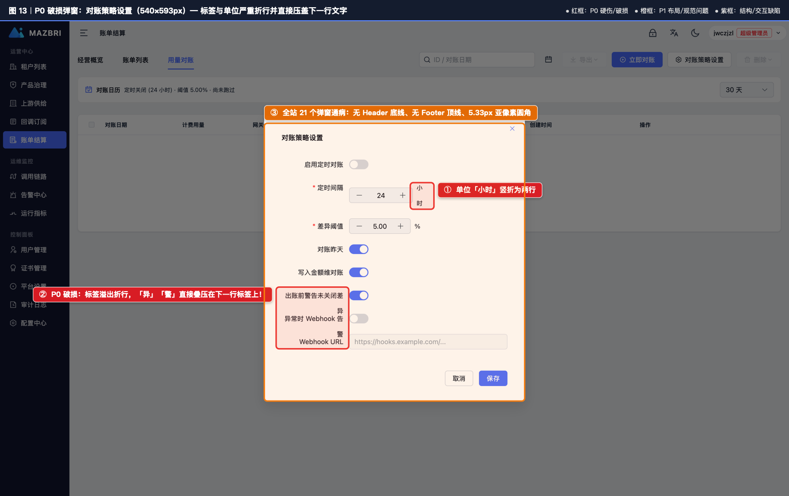

### 2.2 多处未翻译 i18n Key 直接裸露在界面上
1. **运行指标 (`#/ops/runtime`)**：微服务健康拓扑图例直接渲染 3 个原始键名 `ops.components.statusName.healthy`、`ops.components.statusName.degraded`、`ops.components.statusName.down`（仅第 4 个显示中文「未知」）；同时下方「实例健康概览」表格 `CPU 用量`、`内存`、`近 1h 重启` 右对齐并紧贴左对齐的 `异常原因`，造成中段巨大视觉断层。

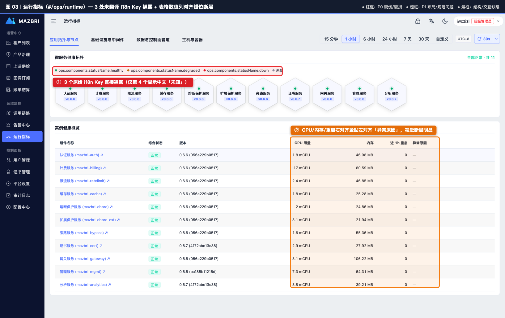

2. **供应商详情 (`#/operations/upstream-supply/suppliers/:id`)**：页头主编辑按钮直接显示未翻译键名 **`common.actions.edit`**。

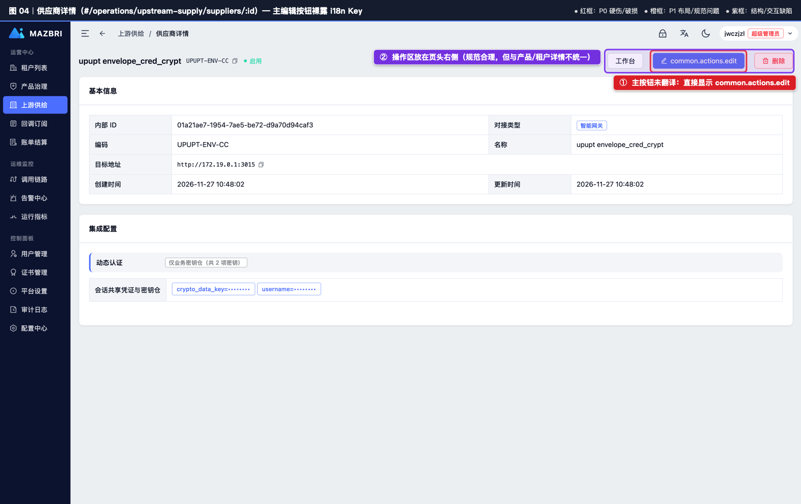

### 2.3 `账单结算 · 经营概览`：KPI 图标丢失 + 图表 Y 轴格式断裂
- **位置**：`#/operations/bills`
- **实测问题**：
  1. 顶部 4 张 KPI 卡片中，`收入` 显示 `¥`、`毛利率` 显示 `%`，而 **`成本` 与 `毛利` 左侧图标位为空白浅蓝方块**（图标名错误或资源缺失）；
  2. `收入/成本/毛利趋势` 图表 Y 轴下半段格式为 `0.00 / 3,000.00 / 6,000.00 / 9,000.00`，上半段突然切换为 `12k / 15k / 18k`，数字精度与单位严重不统一；
  3. 仅 1 日数据时，3 根宽柱孤立居中，左右留白过大。

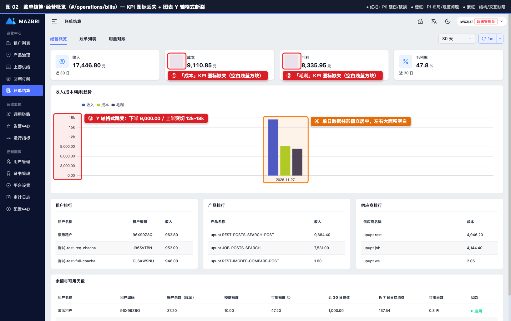

### 2.4 低对比度语义色难以辨认
- **`审计日志` (`#/control-panel/audit-logs`)**：`拒绝` 状态使用高明度浅黄色文字直接印在纯白表格底色上，对比度严重不达标；同时上方工具栏整体右偏漂浮，左侧留出大片死白。
- **`租户详情 · 账户余额`**：`退款` 按钮使用浅黄底 + 浅黄字 + 浅黄框（非标准按钮体系），可读性极差（见图 20）。

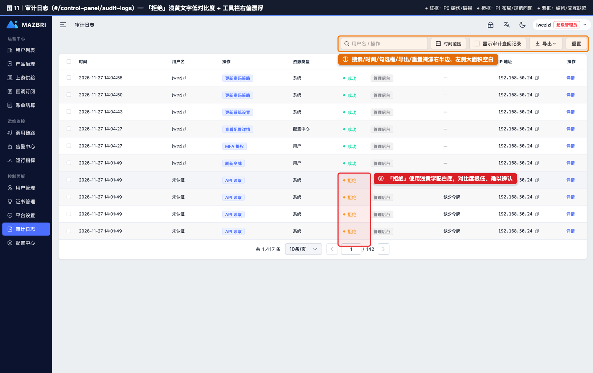

---

## 三、全站页面排版与信息架构共性病症

### 3.1 列表页通病：工具栏“悬空漂移” + 左侧大面积死白 + 未选行亮红删除
- **波及页面**：`租户列表`、`产品治理`、`上游供给`、`回调订阅`、`用户管理`、`证书管理`、`审计日志`、`配置中心`。
- **实测问题**：
  1. 搜索框、导入/导出、新建、删除全部裸漂在灰色页面背景上，脱离下方的白色数据卡片；
  2. 在无 Tab 的单表页中，工具栏全部靠右排列，导致左半屏出现 **600~800px 空白灰带**；
  3. 批量 `删除 v` / `吊销 v` 在 **0 行选中** 时仍以高亮浅红（`el-button--danger is-plain`）紧贴 `+ 新建` 主按钮（而在 `回调订阅` / `账单列表` 中却是灰色禁用态），规范分裂且易造成误触焦虑。

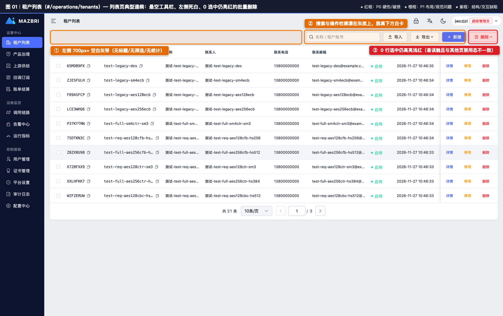

### 3.2 详情页“页头与操作区”存在 3 套互相打架的规范
- **供应商详情（图 04）**：操作按钮（`工作台` / `编辑` / `删除`）放在**页头右侧**，白色卡片内有 `基本信息` 标题。
- **产品详情（图 05）**：页头右侧空空如也，`修改` / `删除` 塞在白色卡片内部右上角，且**卡片左上角没有标题**，留下大片尴尬白边。
- **租户详情（图 19）**：8 个平铺 Tab 信息密度极度失衡（4 个半空、2 个极重），各 Tab 工具栏与操作按钮位置各写各的；`概览 360` 在仅有 1 条错误码时，单根蓝柱直接拉满 100% 宽度，空洞感明显。

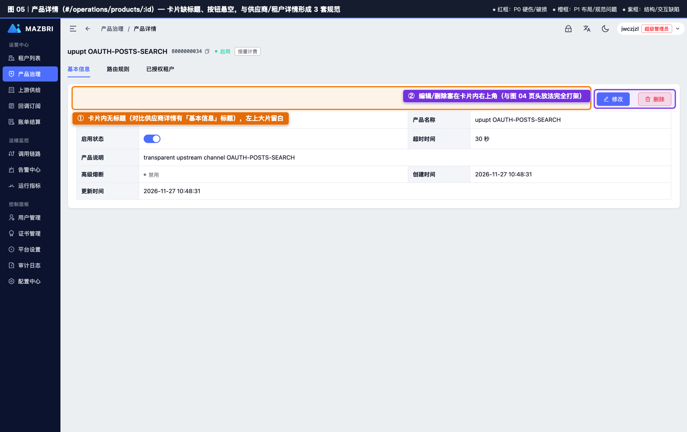

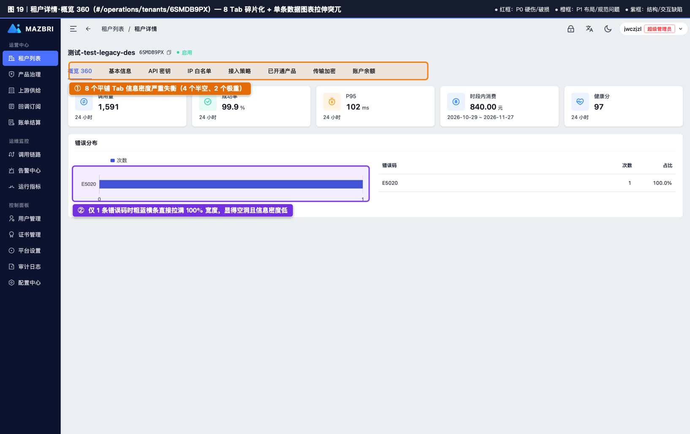

### 3.3 `平台设置`：缺图标、双卡高低不齐、1200px 空白保存条、同页风格切换
- **`基础设置` / `安全策略`（图 06）**：
  - 左卡带蓝色圆角图标徽章，右卡**缺失图标徽章**；
  - 左右双栏高度不齐，底部出现锯齿状缺口；
  - 底部为了放 1 个 74px 宽的 `保存` 按钮，硬铺一条 **1200px 宽的空白白色矩形条**。
- **`平台许可`（图 07）**：切到同页面第 3 个 Tab 后，卡片完全去掉图标徽章和底部保存条，仿佛出自另一套系统。

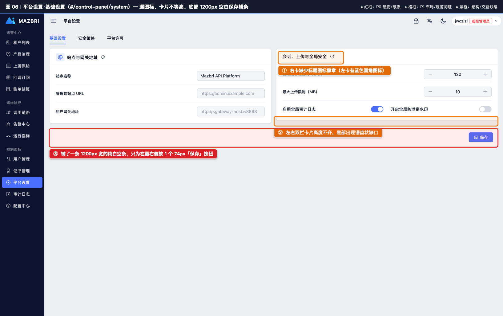

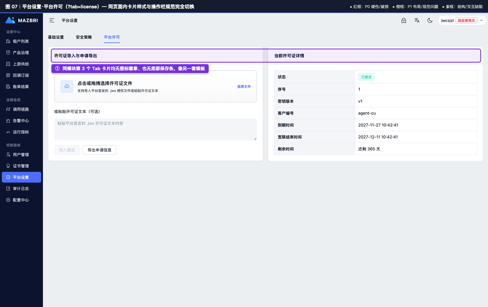

### 3.4 运维监控页面：悬浮工具条、按钮内外分裂、同排图表空态割裂
1. **`调用链路` (`#/ops/traffic`)（图 08）**：快捷筛选芯片（`时延 > 100ms` 等）+ 搜索 + 导出/重置全部夹在两张白卡的灰色缝隙中漂浮；顶部时间窗采用 30px / `0px` 圆角手写控件，与下方 32px Element Plus 按钮高度与圆角均不统一。

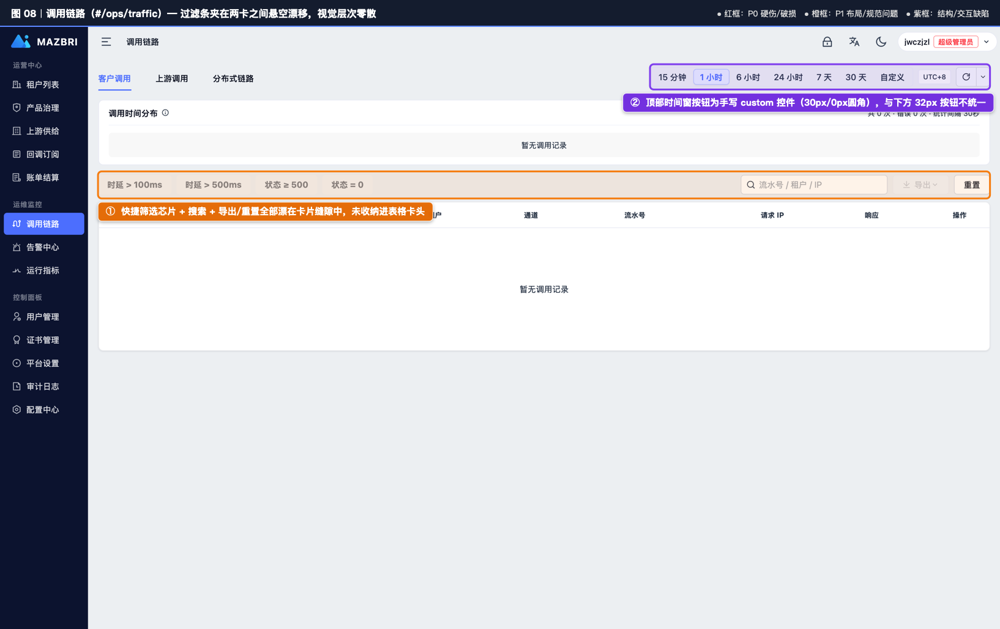

2. **`告警中心 · 告警静默` (`#/ops/alerts?tab=silences`)（图 09）**：`刷新` 漂在卡片外部灰底，而 `新建静默` / `新建抑制` 写在卡片内部，同类操作内外分裂；同时 `告警规则` Tab 列表缺少搜索框与分页。

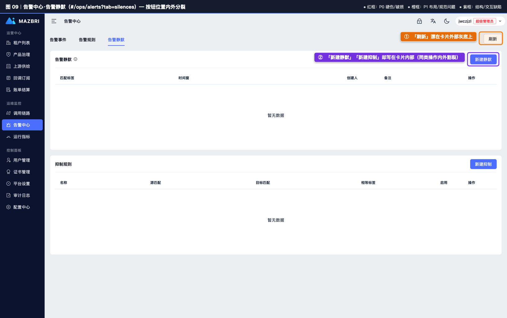

3. **`服务详情` (`#/ops/services/mazbri-gateway`)（图 10）**：左上角完全空缺，未展示服务名称/状态页头；`黄金指标 (RED)` 同排 3 张卡片中，左侧 QPS 绘制 0 轴折线，右侧 2 张却展示巨大的 Element Plus 默认灰色纸箱空态图，视觉割裂严重。

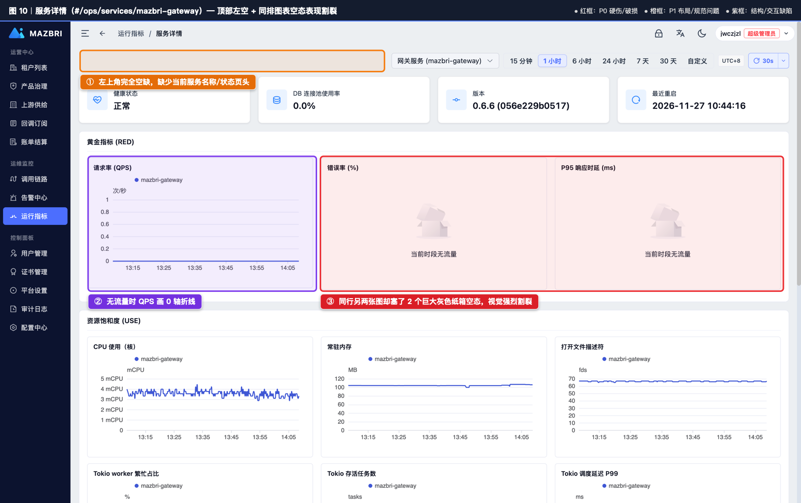

### 3.5 `免代码接入工作台` (`#/operations/upstream-supply/workbench`)：脱离设计体系 + 入口重复
- 整页为独立全屏 IDE，自造 `0px / 3px / 4px` 圆角与 `22 / 26 / 28 / 34 / 35 / 36px` 按钮高度，与主站设计语言完全割裂；
- `全局环境 (0)` 在**右上角工具栏**与**左下角状态栏**重复出现两次。

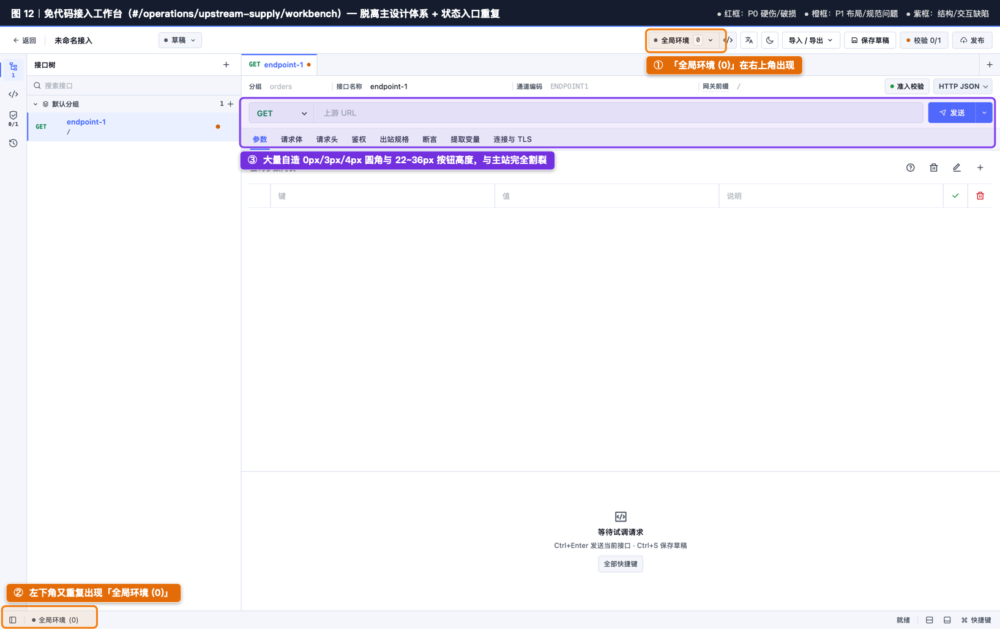

---

## 四、DOM、Design Token 与按钮/控件量化分析

### 4.1 全站 648 个可见按钮量化统计

| 维度 | 实测分布 | 诊断结论 |
| :--- | :--- | :--- |
| **组件来源** | `custom` 手写按钮 **303 个 (46.8%)**、`link` **282 个**、`default` **29 个**、`primary` **20 个**、`plain` **14 个** | 近半数交互按钮绕过组件库手写，导致样式与 Hover 无法统一维护 |
| **按钮高度** | 共 **18 种高度**：`24px`(274)、`32px`(130)、`17px`(115)、`34px`(31)、`28px`(23)、`23px`(11)、`30px`(10)、`39px`(10)、`35px`(9)、`36px`(9) 等 | 应严格收敛为 `32px`（标准）/ `28px`（紧凑）/ `24px`（表格行内）三档 |
| **圆角半径** | 共 **8 种圆角**：`3.33333px`(406)、`5.33333px`(105)、`0px`(74)、`999px`(28)、`4px`(16)、`50%`(11)、`3px`(7)、`8px`(1) | `--art-form-control-radius: calc(var(--custom-radius) / 3 + 4px)` 产生大量亚像素小数圆角，应废除除法公式，统一为 `6px` / `10px` / `999px` |

### 4.2 亮/暗双模式真实鼠标 Hover 实测对照

| 控件类型 | 亮色模式常态 → Hover | 暗色模式常态 → Hover | 问题诊断 |
| :--- | :--- | :--- | :--- |
| **主按钮 (`+ 新建`)** | `rgb(93,135,255)` → `rgb(141,171,255)` | `rgb(93,135,255)` → `rgb(65,94,178)` | **亮色模式 Hover 变淡发白**（反直觉），应改为加深 8~10% |
| **次按钮 (`导入`)** | 白底 → `rgb(238,243,255)` 浅蓝底 | 透明 → `rgb(9,13,25)` 近黑底 + 深蓝框 | **暗色模式 Hover 几乎不可见**（`#090d19` 压在 `#0b0b0c` 上） |
| **表格行内 Link (`详情`)** | 透明 → `rgb(238,243,255)` | 透明 → `rgb(9,13,25)` | **暗色模式 Hover 背景与 `#111112` 卡片几乎无色差** |
| **表格普通行 (`tr`)** | `rgb(255,255,255)` → `rgb(255,255,255)` (`changed: false`) | `rgba(38,39,39,0.09)` → `rgba(38,39,39,0.93)` | **亮色模式行悬停缺少明确背景层级反馈** |
| **侧栏未激活菜单** | 透明 → `rgba(255,255,255,0.08)` | 激活态退化为 `#1d1d20` 灰底 | **暗色模式丢失品牌蓝激活态** |

---

## 五、弹窗（Modal）与抽屉（Drawer）全量诊断

### 5.1 实测 24 个浮层全量明细（21 Dialog + 3 Drawer）

| 入口页面 → 触发按钮 | 类型 | 标题 | 实测尺寸 (px) | 头/尾分割线 | 表单 Label 对齐 & 项数 | 主要缺陷 |
| :--- | :--- | :--- | :--- | :--- | :--- | :--- |
| 租户列表 → 新建 | Dialog | 新增租户 | `550 × 537` | 无 / 无 | `right` · 6 项 | 缺分割线、非标宽度 |
| 租户列表 → 导入 | Dialog | 导入 | `700 × 333` | 无 / 无 | 无表单 | 缺分割线 |
| 产品治理 → 新建 | Dialog | 新增产品 | `560 × 379` | 无 / 无 | **`left`** · 5 项 | **全站唯一 `left` 对齐** |
| 授权/订阅 → 新建 | Dialog | 新建授权 | `560 × 385` | 无 / 无 | `right` · 4 项 | 主按钮叫「开通」 |
| 上游供给 → 微服务接入 | Dialog | 微服务接入 | `600 × 643` | 无 / 无 | `right` · 11 项 | 4 步向导重表单硬塞弹窗 |
| 通道列表 → 新建 | Dialog | 新增通道 | `640 × 514` | 无 / 无 | `right` · 6 项 | 主按钮叫「保存」 |
| 回调订阅 → 新建 | Dialog | 新建回调订阅 | `560 × 369` | 无 / 无 | `right` · 4 项 | 主按钮叫「确定」 |
| 账单列表 → 生成 | Dialog | 生成账单 | `560 × 321` | 无 / 无 | `right` · 3 项 | 缺分割线 |
| 用量对账 → 对账策略设置 | Dialog | 对账策略设置 | `540 × 593` | 无 / 无 | `right` · 8 项 | **P0：文字折行重叠压盖** |
| 告警规则 → 新建规则 | Dialog | 新建规则 | **`600 × 798`** | 无 / 无 | `right` · 10 项 | **800px 顶天立地，应改抽屉** |
| 告警静默 → 新建静默 | Dialog | 新建静默 | `480 × 410` | 无 / 无 | `right` · 4 项 | 缺分割线 |
| 用户管理 → 新建 | Dialog | 新增用户 | `520 × 589` | 无 / 无 | `right` · 7 项 | 缺分割线 |
| 用户管理 → 详情 | **Drawer** | tenant_viewer | `560 × 985` | 无 / **无 Footer** | — | 高危操作区红/黄/灰混杂 |
| 证书管理 → 签发 | Dialog | 签发证书 | `600 × 295` | 无 / 无 | `right` · 2 项 | 缺分割线 |
| 证书管理 → 详情 | **Drawer** | mazbri-gateway | `680 × 985` | 无 / **无 Footer** | — | **头部硬塞 3 种风格按钮紧贴 X** |
| 审计日志 → 详情 | **Drawer** | 释放产品编码 | `760 × 985` | 无 / **无 Footer** | — | 缺头部分割线 |
| 配置中心 → 新建 | Dialog | 新建配置 | **`820 × 741`** | 无 / 无 | **`top`** · 2 项 | **代码编辑器塞弹窗 + `top` 对齐** |
| 配置中心 → 编辑/历史 | Dialog | MFA 提权 | `440 × 344` | 无 / 无 | `right` · 1 项 | 缺分割线 |
| 租户详情 → 充值 | Dialog | 账户充值 | `450 × 412` | 无 / 无 | `right` · 3 项 | 非标 450px 宽 |
| 租户详情 → 开通/白名单/编辑 | Dialog | 开通产品等 | `550~560` | 无 / 无 | `right` · 2~4 项 | 按钮文案混用「确定/保存/开通」 |
| 产品详情 → 修改 | Dialog | 编辑产品配置 | `560 × 542` | 无 / 无 | `right` · 5 项 | 缺分割线 |

### 5.2 弹窗与抽屉核心结论与截图证据

1. **100% 弹窗缺失三段式边界**：21 个 Dialog 全部 `headerBorderBottom: 0px`、`footerBorderTop: 0px`，内容与操作区缺乏分隔；同时出现 **11 种随机弹窗宽度**（`440 / 450 / 480 / 520 / 540 / 550 / 560 / 600 / 640 / 700 / 820px`），以及 **`left / right / top` 3 种表单对齐混用**。
2. **重表单与代码编辑器错误使用居中 Dialog**：`新建规则 (600×798)`、`微服务接入 (600×643)`、`新建配置 (820×741)` 均应改为右侧 `Drawer`。

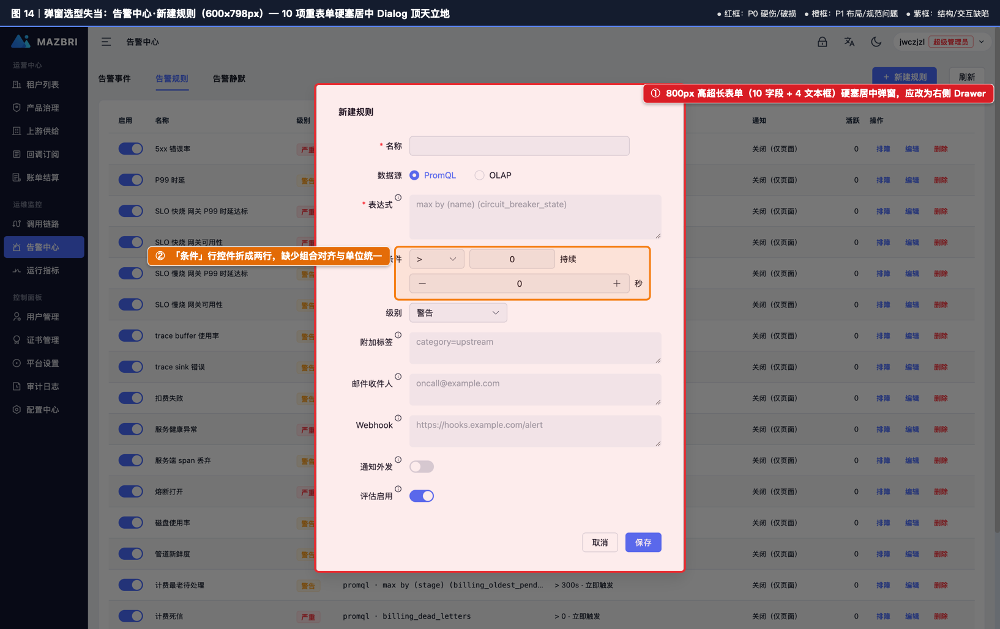

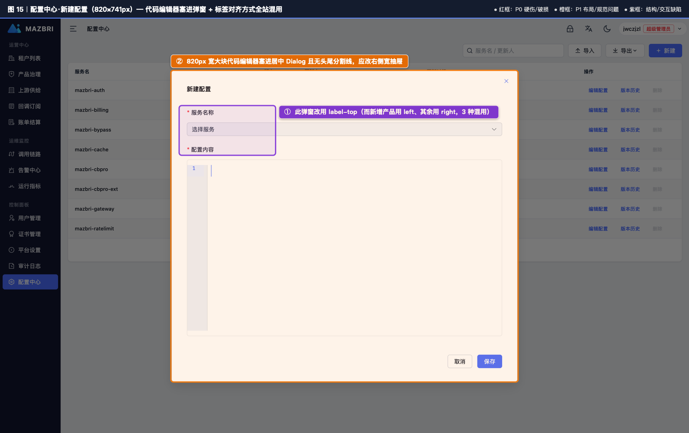

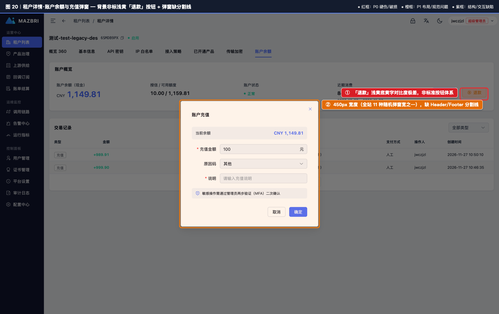

3. **抽屉（Drawer）缺少头部分割线与吸底 Footer，且头部操作过载**：`证书详情` 头部横塞 3 个不同风格按钮紧贴关闭 `X`；`用户详情` 内部高危操作按钮风格杂乱。

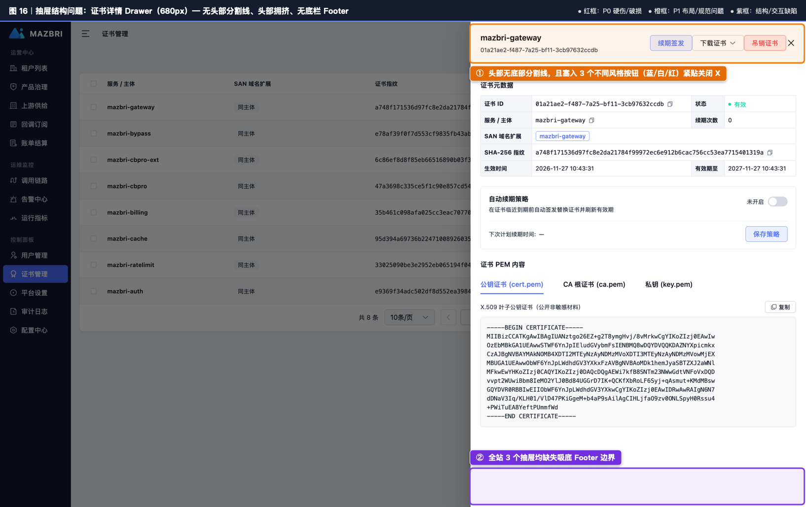

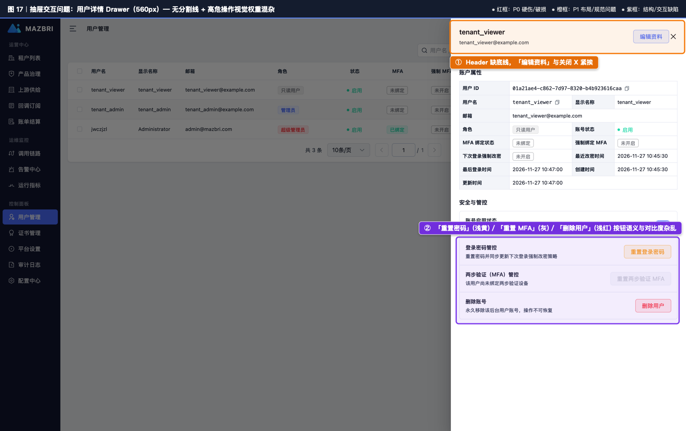

---

## 六、暗色模式专项诊断

开启顶栏暗色模式后，系统视觉质量明显低于亮色模式，出现 4 类集中退化（见图 18）：

1. **侧栏激活态失去品牌色**：激活项从品牌蓝 `#5d87ff` 退化为深灰 `#1d1d20`，与未激活项几乎融为一体；
2. **画布与卡片层次塌陷**：`--default-bg-color: #0b0b0c` 与 `--default-box-color: #111112` 亮度差过小，且卡片描边仅 `--art-card-border: #ffffff08`（3% 白），表格卡片边界几乎不可见；
3. **Tooltip 未适配暗色**：鼠标悬停顶栏图标时，直接弹出**刺眼纯白气泡**（`主题切换功能 (明暗主题)`）；
4. **暗色 Hover 反馈几乎失效**：次按钮与表格行内 Link 悬停背景为 `rgb(9,13,25)`，在深黑表面上肉眼难以察觉。

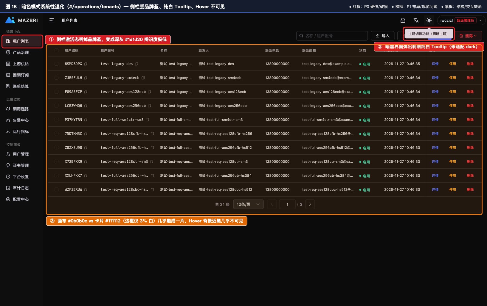

---

## 七、保留原主题的整站重构优先级路线图

在完整保留 **深海蓝侧栏 + 浅灰画布 + 品牌蓝 `#5d87ff` + 白色卡片** 的前提下，建议按以下 4 个阶段推进：

### P0｜立即止血（修复所有硬性破损，1~2 天）
- 补齐 4 处裸露 i18n Key：`common.actions.edit`、`ops.components.statusName.{healthy,degraded,down}`；
- 修复 `对账策略设置` 弹窗：加大 `label-width` 或改用 `label-position="top"`，单位「小时」设 `white-space: nowrap`；
- 修复 `账单结算 · 经营概览`：`成本`/`毛利` 补全 KPI 图标，统一趋势图 Y 轴格式化函数（全轴统一 `¥0` / `¥3k` 或统一千分位小数）；
- 提高 `审计日志`「拒绝」与 `账户余额`「退款」的文字对比度（改用深琥珀 `#b45309` 或标准次按钮样式）；
- 修复暗色模式：恢复侧栏品牌蓝激活态、Tooltip 跟随 dark 主题、提升暗色卡片边框（`rgba(255,255,255,0.10)`）与 Hover 表面亮度（`rgba(255,255,255,0.08)`）。

### P1｜收敛全站 Design Token 与基础控件规范（3~5 天）
- **圆角 Token**：废除 `calc(var(--custom-radius) / 3 + ...)` 亚像素公式，锁定 `6px`（按钮/输入框/下拉框）、`10px`（卡片/弹窗）、`999px`（状态胶囊）；
- **按钮规范**：统一为 `32px`（工具栏/表单主次按钮）与 `24px`（表格行内 Link）；亮色主按钮 Hover 改为加深 8~10%（如 `#4a73eb`）；表格无勾选行时，批量 `删除`/`吊销` 按钮统一隐藏或置为灰态禁用；
- **表格规范**：开启明确行 Hover 底色（亮色 `#f8fafc` / 暗色 `rgba(255,255,255,0.04)`）；所有数值/金额/耗时列统一 `align="right"` 且确保与右侧文本列保持合理列间距。

### P1｜统一 3 类核心页面骨架模板（1 周）
1. **标准列表页模板**：将搜索、筛选、批量/新建按钮全部收纳进主卡片的 `Card Header`（左筛选、右操作，底部分割线 `1px solid`），彻底消灭悬空工具栏与左侧死白；
2. **标准详情页模板**：全站统一为「实体页头（名称 + 编码复制 + 状态 + 全局主/次操作）→ Tab 栏 → 带标题的内容卡片」，对齐租户详情、产品详情、供应商详情与服务详情；并将租户详情 8 Tab 合理归并为 5 组；
3. **标准设置页模板**：双栏卡片等高拉伸（`align-items: stretch`）、统一卡片标题图标规范，删除底部 1200px 空白保存横条（改为右上角保存或脏数据触发的紧凑吸底操作栏）。

### P2｜重构弹窗/抽屉体系与重表单迁移（1 周）
- **三段式结构**：所有 Dialog 与 Drawer 强制规范 `Header`（底边 1px 分割线）+ `Body`（独立滚动）+ `Footer`（顶边 1px 分割线、固定底栏）；
- **宽度三档收敛**：Dialog 仅允许 `480px`（确认/简单表单）、`600px`（中等表单）、`760px`（宽表单/导入）；Drawer 仅允许 `560px` / `720px`；
- **表单对齐与文案**：所有表单统一 `label-position="top"`（或固定宽 `right` 且禁止折行）；主确认按钮按动作语义统一为「确定新建 / 保存修改 / 确认提交」；
- **重表单迁移**：将 `告警中心 · 新建规则`、`上游供给 · 微服务接入`、`配置中心 · 新建配置` 从居中 Dialog 迁移为右侧 Drawer；清理抽屉头部过载按钮（主要动作移入 Footer，次要/危险动作收进「更多」下拉菜单）。
