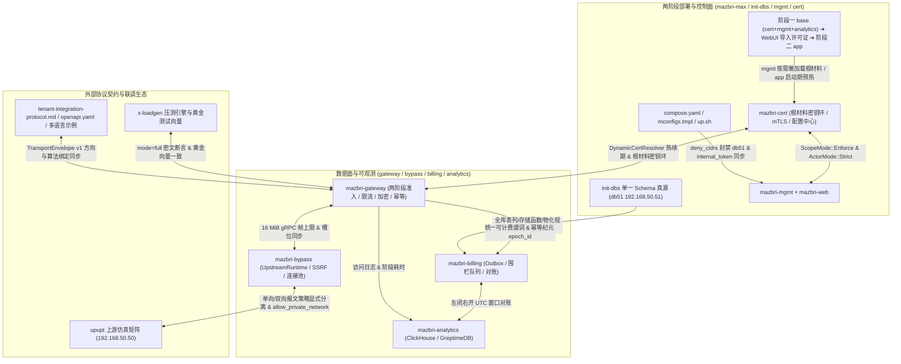

# 全量代码审计第一性原理归因与分步治理方案总览

## 1. 第一性原理根因矩阵（七大架构公理失守）

`mazbri` 具备零 `unsafe` 业务代码、双工作区 `clippy::pedantic` 零警告门禁与完整的模块化分层，但编译器与静态检查仅能约束单函数或单结构体内的局部类型与内存安全，无法自动保证**跨租户空间、跨协议阶段、跨进程生命周期、跨时钟域与跨库账本**的系统级不变量。全仓检出的真实缺陷均可归结为以下七条第一性原理的失守：

| 公理编号 | 第一性原理（核心不变量） | 架构失守本质 | 衍生典型缺陷簇 |
| :--- | :--- | :--- | :--- |
| **A1** | **多租户空间正交隔离公理**：共享基础设施中任何跨请求持久化键都是请求等价类的投影，投影函数必须包含不可约安全主体维度 `(tenant_id, product_id, route_version, security_mode)` | 全局键仅对客户端输入做哈希或裸串拼接，丢失租户与安全上下文，导致等价类跨租户坍缩 | 网关全局 `idempotency_key` 串漏与明文降级、计费 `Uuid::new_v5(fp)` 跨租户与跨日免单、响应缓存共享命名空间串漏、`cbpro-ext` 裸主键覆盖与回源失配 |
| **A2** | **密文载荷与策略平面同构公理**：配额、计费预检与产品授权必须在“身份已验证且业务意图（目标资源与载荷体积）已可观测”的平面执行，且同一维度配额在单次请求内至多扣减一次 | 外层 `TransportEnvelope` 将业务意图推迟到 Handler 解密后才显现，风控集中前置在仅见密文外壳的中间件层，缺少“外层连接配额 + 解密后业务门禁”正交切分 | `request`/`full` 加密租户绕过余额预检无限透支、加密租户绕过产品/路径限流、Chunked 传输按 `Content-Length: 0` 绕过入向带宽预扣、幂等早于产品鉴权执行 |
| **A3** | **信任边界强类型解析与防混淆代理人公理**：跨越信任边界的输入必须在入口解析为受约束领域类型（Parse, don't validate），高权限代理转发或凭据自动回填必须绑定原始目标授权域 | 以裸 `String` 拼接代理路径、SQL 与 URL 占位符；控制面在目标 Origin 变更时仍自动回填历史加密凭据；内部服务配置模板保留宽松模式 | 证书代理 `Path<String>` 路径穿越窃取根主密钥与篡改配置、工作台反开草稿与掩码回填外泄生产密钥与超管私钥、`::ffff:` IPv4-mapped IPv6 与重定向穿透 SSRF、`job_poll` 覆盖 `base_url`、ClickHouse 反斜杠逃逸、`cert-bootstrap.toml` 宽松审计模式 |
| **A4** | **动态状态流引用公理**：长生命周期进程中的证书、密钥环、角色、启用状态与配置版本号是随时间演化的状态流（State Stream），消费者必须持有动态解析句柄而非启动期值拷贝 | 控制面实现了续期、吊销与轮换落库，数据面在启动瞬间按值克隆快照，且就绪探针混淆“临期预警”与“实际过期”，造成控制面、探针与传输层三方分叉 | 全集群 `CertManager` 假续期与许可证宽限期提前 29 天 `503` 雪崩、证书吊销数据面无感知、许可证 `Rekey` 损坏存量微服务私钥与多版本密钥环、管理端长效 Access Token 无状态逃逸、`mazbri-registry` 硬编码 `version=0` 引发 30s 重载风暴、双份脱节 `AdminState` |
| **A5** | **异步取消异常安全与时钟域隔离公理**：Tokio Future 可在任意 `.await` 被同步销毁，跨挂起点的共享状态变更必须由 RAII `Drop` 守卫收敛；单调开机时钟 `Instant` 与跨机墙钟 `DateTime<Utc>` 不可跨重启逆推相减；请求级异常爆炸半径不得穿透至整进程 `abort()` | 手工在 `.await` 后清理占槽、归池与计数；将跨重启持久化的 `Utc` 差值直接从本机 `Instant::now()` 减去并 `.unwrap()`；未挂载或跨线程丢失线程局部 `RECOVERABLE_DEPTH` | `TokenCache` Singleflight 取消后永久死锁、`WsConnGuard` 超时归还脏连接致跨租户串流、宿主机重启后 `DistributedCircuitBreaker` 与 `cbpro` 下溢崩溃、回调退避 `i64::MAX` 毒丸死循环杀死网关、`config_watch` 通道关闭空转死循环、前端切换无序号守卫错写私钥 |
| **A6** | **密码学域分离与组合安全公理**：AEAD 与流密码要求 `(Key, Nonce)` 在密钥全生命周期严格唯一；认证标签必须绑定方向、算法 ID 与归属实体；请求与响应方向加解密契约必须显式声明且默认拒绝静默回退 | 多字段循环共享单次 IV、`KeyDerive` 静态截断充当 AEAD Nonce；供应商凭据回退公开 `DEV_SEED` 且空 AAD；`TransportEnvelope` 无方向域隔离；配置中心与 MFA 共用派生键；`crypto_wire` 验签失败静默回退明文 | 上游 `NamedFields` 与 `KeyDerive` 造成 GCM/CTR Nonce 重用、`supplier_secrets` 硬编码弱种子、`TransportEnvelope` 请求/响应反射混淆、配置中心与 MFA 共用 `"mazbri-mfa-v1"` 密钥、上游单向与双向报文加密语义混同 |
| **A7** | **分布式账本单一事实源（SSOT）与单调围栏公理**：货币最小精度在表列、存储函数与 RPC 间必须同构；异步队列重试与超时回收必须携带单调递增围栏令牌（Fencing Token）；实时扣费、出账、看板物化视图与对账必须复用同一可计费谓词与左闭右开时间区间 | 库表与存储函数混用 `DECIMAL(18,4)` 与 `DECIMAL(18,6)`、RPC 底数 `100^decimals` 笔误；无条件 `UPDATE` 覆盖已完成扣款；多套 SQL 各自硬编码状态码与时间边界；监控引擎缺失完整时间窗与表约束对齐 | RPC 充值缩水 100 倍与毫元归零、`usage_charge_queue` 重复扣费、负单价反向增资、余额预检双扣与 TTL 续期锁死 `402`、4xx 扣款/账单/物化视图三方分裂、日终漏算 999ms、告警唯一索引残留死状态谓词、SLO 窗口错配与故障返 `1.0`、异常检测残缺小时误报 |

---

## 2. 全局二阶与三阶影响耦合图谱

单点修补往往在相邻子系统、联调工具链或两阶段部署拓扑中引发次生故障。本治理方案在每一步均纳入跨仓全链路约束：

### 核心跨界二阶/三阶效应守卫准则

1. **租户传输协议原位加固与四端契约锁步同步**
   - 直接在 [transport.rs](file:///workspace/rust-proj/mazbri/mazbri-libs/mazbri-core/src/crypto/transport.rs) 的 `TransportEnvelope` v1 上完成请求/响应四向子密钥派生、算法与主体 AAD/MAC 绑定及 `sm4-ecb-pkcs7` 空 IV 对齐，不引入并行信封版本。同步重生成 [tenant-integration-v1.json](file:///workspace/rust-proj/mazbri/docs/protocol-vectors/tenant-integration-v1.json) 黄金测试向量，并一次性对齐 [tenant-integration-protocol.md](file:///workspace/rust-proj/mazbri/docs/tenant-integration-protocol.md)、[openapi.yaml](file:///workspace/rust-proj/mazbri/mazbri-bin/mazbri-gateway/openapi.yaml)、多语言校验示例与 `x-loadgen`（[transport.rs](file:///workspace/rust-proj/x-loadgen/x-loadgen-libs/x-loadgen-core/src/crypto/transport.rs)）。
2. **混合网络防 SSRF 底座黑名单与内部服务鉴权**
   - 联调栈 `upupt` 运行于宿主机 `192.168.50.50`，企业专网部署常需开启 `[ssrf] allow_private_network = true`。通过修复 IPv4-mapped IPv6 默认拦截、在 `SsrfConfig` 引入跨内外网模式强制生效的 `deny_cidrs` 与 `deny_hosts`（由部署模板自动注入 `db51` `192.168.50.51/32` 及内部服务域名），并为 `mazbri-analytics` 启用内部令牌鉴权，在保持 `upupt` 与专网上游连通的同时彻底隔离平台数据库与内部控制面。
3. **商业根保护材料单一密钥根与两阶段冷启动不变量**
   - 彻底移除 `DEV_SEED`、`MAZBRI_SUPPLIER_SECRETS_KEY` 及任何历史密文双读分支：供应商与渠道凭据统一由 `mazbri-cert` 商业根保护材料密钥环派生 `enc:v3:` 加密并绑定实体 AAD；配置中心敏感项独立派生 `enc:cfg:v2:`。
   - 严格守卫平台不可变的两阶段冷启动拓扑：阶段一（`./up.sh base`）在空库无许可证状态下拉起 `mazbri-cert`、`mazbri-mgmt` 与 `mazbri-analytics`，管理员经 `mazbri-mgmt` WebUI 导入商业许可证激活内部 CA 与根保护材料、签发 mTLS 证书并初始化配置中心，随后阶段二（`./up.sh app`）启动其余 8 个数据面微服务。因此 `mazbri-mgmt` 在进程启动期严禁强校验根保护材料，必须保持在读写凭据时按需拉取并缓存多版本密钥环；阶段二启动的 `mazbri-gateway` 与 `mazbri-bypass` 则在启动期直接预热根材料密钥环。
4. **控制面强制鉴权模式与 mTLS 微服务启动链路对齐**
   - `mazbri-cert` 代码默认值与 [cert-bootstrap.toml](file:///workspace/rust-proj/mazbri-max/docker/mconfigs.tmpl/cert-bootstrap.toml) 同步锁定 `scope_mode = "enforce"` 与 `actor_mode = "strict"`。数据面各微服务启动期持专属派生 Bearer 令牌按序访问 `GET /configs/{service}`、`GET /certificates/by-subject/{subject}`、`POST /renew/{id}` 与 `/nodes/*`（均属免操作人头的服务自属或共享接口），`mazbri-mgmt` 代理请求全程注入 `x-mazbri-actor` v2 HMAC 声明，并在根材料权限表补齐 `ServiceName::Bypass`，全链路零启动阻断。
5. **单一 Schema 真源与零死代码架构清洁**
   - 所有 PostgreSQL 表结构、生成列、PL/pgSQL 存储函数、唯一索引及物化视图变更直接写入 `mazbri-max/init-dbs` 基线 Schema，通过 `redep rerun` 完成纯净初始化，不保留在线过渡迁移脚本或旧数据兼容分支。同步删除业务端口 `:8888/metrics` 遗留端点、无人挂载的鉴权与计费中间件及前端模板遗留文件与冗余依赖。

---

## 3. 八步串行可落地治理路线图

每一步均为可独立编译、通过全量静态门禁与单测、按拓扑顺序部署并闭环验证的原子交付单元：

| 步骤 | 文档 | 治理主题 | 解决的核心问题域 | 涉及变更与验证服务 |
| :--- | :--- | :--- | :--- | :--- |
| **Step 01** | [01-step01-runtime-panic-and-clock-safety.md](file:///workspace/rust-proj/mazbri/docs/audit-remediation-plan/01-step01-runtime-panic-and-clock-safety.md) | 进程级 Panic 隔离闭环、单调时钟解耦与探针就绪语义校准 | 跨重启 `Instant` 下溢、回调退避溢出、请求子任务 Panic 穿透、临期探针误摘流与 `SIGTERM` 停机 | `cert` ➔ `analytics` ➔ `cbpro` ➔ `bypass` ➔ `gateway` ➔ `mgmt` |
| **Step 02** | [02-step02-trust-boundary-ssrf-and-proxy-hardening.md](file:///workspace/rust-proj/mazbri/docs/audit-remediation-plan/02-step02-trust-boundary-ssrf-and-proxy-hardening.md) | 出站 SSRF 统一底座、控制面代理强类型化与防混淆代理人 | 证书代理穿越、工作台掩码回填窃密、IPv4-mapped IPv6 与 `deny_cidrs`、`cert-service` 强制鉴权与续期指纹同步、可信代理 IP | `cert` ➔ `ratelimit` ➔ `analytics` ➔ `bypass` ➔ `gateway` ➔ `mgmt` |
| **Step 03** | [03-step03-dataplane-tenant-isolation-and-encrypted-gate.md](file:///workspace/rust-proj/mazbri/docs/audit-remediation-plan/03-step03-dataplane-tenant-isolation-and-encrypted-gate.md) | 数据面多租户状态键隔离与解密后统一风控门禁 | 幂等串漏与明文降级、纪元计费 `event_id`、密文余额与单次限流分拆、数据面租户白名单、清理 `:8888/metrics` 与死中间件 | `init-dbs` (`platform`) ➔ `auth` ➔ `gateway` ➔ `mgmt` |
| **Step 04** | [04-step04-crypto-domain-separation-and-mtls-lifecycle.md](file:///workspace/rust-proj/mazbri/docs/audit-remediation-plan/04-step04-crypto-domain-separation-and-mtls-lifecycle.md) | 密码学域分离、落库密钥收敛与全集群 mTLS 动态热重载 | 动态 mTLS 续期与 Peer SAN ACL、单一 `enc:v3:`/`enc:cfg:v2:` 密钥环、上游请求/响应加密显式分离、`TransportEnvelope` v1 四向绑定与 `x-loadgen` 同步 | `init-dbs` (`cert`) ➔ `cert` ➔ 数据面各服务 ➔ `gateway` ➔ `mgmt` + `x-loadgen` |
| **Step 05** | [05-step05-async-cancellation-resilience-and-caching.md](file:///workspace/rust-proj/mazbri/docs/audit-remediation-plan/05-step05-async-cancellation-resilience-and-caching.md) | 异步取消安全、连接池、响应缓存隔离与通道级熔断治理 | `TokenCache`/`WsPool`/回调队列取消与租约恢复、16MiB 帧对齐、租户缓存隔离、通道级熔断与监控指标对齐、`config_watch` 幂等广播 | `init-dbs` (`platform`) ➔ `cache` ➔ `cbpro` ➔ `cbpro-ext` ➔ `bypass` ➔ `gateway` ➔ `analytics` ➔ `mgmt` |
| **Step 06** | [06-step06-billing-ledger-fencing-and-reconciliation.md](file:///workspace/rust-proj/mazbri/docs/audit-remediation-plan/06-step06-billing-ledger-fencing-and-reconciliation.md) | 分布式账务精度同构、单调租约围栏与全链路对账 SSOT | 全表与存储函数 `DECIMAL(18,6)` 同构、RPC 微元换算、队列 `lease_seq` 围栏、单租户余额缓存定向失效、4xx 与物化视图及对账口径统一 | `init-dbs` (`billing`) ➔ `billing` ➔ `gateway` ➔ `mgmt` |
| **Step 07** | [07-step07-control-plane-rbac-session-and-transactions.md](file:///workspace/rust-proj/mazbri/docs/audit-remediation-plan/07-step07-control-plane-rbac-session-and-transactions.md) | 控制面细粒度 RBAC 裁剪、会话纪元校验与事务一致性 | 三角色前后端零 403 同步裁剪、固定短效 Access Token 与 `auth_epoch` 实时复核、分类提权窗口新鲜度收口、防锁死超管、多表事务与配置中心 CAS | `cert` ➔ `mgmt`（含前端 `pnpm build`） |
| **Step 08** | [08-step08-observability-frontend-hygiene-and-ci-cd.md](file:///workspace/rust-proj/mazbri/docs/audit-remediation-plan/08-step08-observability-frontend-hygiene-and-ci-cd.md) | 可观测四大引擎校准、前端安全/竞态清理与确定性 CI 发版 | ClickHouse 参数绑定与 `internal_token`、SLO/告警/异常/安全引擎校准、全屏工作台浮层层级、前端请求序号守卫、`ts-rs` 与模板死代码清理、锁定 Tag SHA 发版 | `init-dbs` (`admin`) ➔ `analytics` ➔ `mgmt`（含前端 `pnpm build`）+ CI 校验 |

---

## 4. 通用交付门禁与验证准则

> [!IMPORTANT]
> **工程门禁要求**
> 1. 凡涉及 `mazbri-web` 或 `mazbri-mgmt` 的步骤，必须先在 `mazbri-web` 执行 `pnpm build` 与全仓 `src/**/*.test.ts` 单测，再执行 `mazbri-libs` 与 `mazbri-bin` 的 `--release --locked --workspace --all-targets -- -D warnings` Clippy 校验及全量 `cargo test`，确保 [generated](file:///workspace/rust-proj/mazbri/mazbri-web/src/types/api/generated) 绑定零未提交差异。
> 2. 涉及 `mazbri-max/init-dbs` Schema、存储函数或部署配置模板（`mconfigs.tmpl`、`up.sh`）变更的步骤，直接更新基线定义并通过 `redep rerun` 完成全量初始化与两阶段冷启动闭环验证；纯二进制修复采用 `/tmp` 原子 `mv` + `docker restart` 热替换（`cert`、`auth`、`billing`、`cache`、`ratelimit`、`cbpro`、`cbpro-ext` 容器内二进制带 `-service` 后缀），禁止对已热替换容器执行 `docker compose up -d`。
> 3. 每次控制面或前端变更完成后，通过 `9223`/`9224` 浏览器在 `1440×900` 与 `1920×1080` 双分辨率、明暗双主题及 `R_ADMIN` / `R_FINANCE` / `R_VIEWER` 三角色下完成零控制台报错、零越权 `403` 请求实测闭环。
