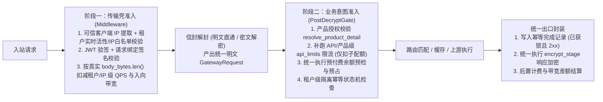

# Step 03：数据面多租户状态键空间隔离与解密后统一风控门禁

## 1. 检测出的问题清单与源码定位

| 编号 | 级别 | 问题描述 | 精确源码位置 |
| :--- | :--- | :--- | :--- |
| **S03-1** | Critical | `keys::idempotency_key` 仅按 `sha256(fingerprint)` 生成全局键 `{prefix}:idempotency:{hash}`，未绑定 `tenant_id`、`product_id`、`method`、`path` 与请求体哈希；且 `idempotency_stage` 先于产品授权 `resolve_product_detail` 执行，导致跨租户可越权读取缓存响应并免计费 | [keys.rs](file:///workspace/rust-proj/mazbri/mazbri-libs/mazbri-core/src/redis/keys.rs#L51-L55)、[handler.rs](file:///workspace/rust-proj/mazbri/mazbri-bin/mazbri-gateway/src/gateway/handler.rs#L151-L170) |
| **S03-2** | Critical | `complete_idempotency` 将加密前的**明文**响应写入 Redis，`replay_response` 直接原样返回明文跳过 `encrypt_stage`，导致 `encryption_mode = "full"` 租户重放时降级为明文传输并使客户端解包失败；且 `SET NX EX 86400` 占槽后遇鉴权失败、上游 4xx/5xx 或超时取消无清理逻辑，锁死 `409` 长达 24h | [handler.rs](file:///workspace/rust-proj/mazbri/mazbri-bin/mazbri-gateway/src/gateway/handler.rs#L191-L195)、[handler.rs](file:///workspace/rust-proj/mazbri/mazbri-bin/mazbri-gateway/src/gateway/handler.rs#L376-L456)、[crypto.rs](file:///workspace/rust-proj/mazbri/mazbri-bin/mazbri-gateway/src/crypto.rs#L866-L928) |
| **S03-3** | Critical | 计费 `build_usage_event` 对带 `fingerprint` 的请求使用 `Uuid::new_v5(NAMESPACE_OID, fp)` 生成不含 `tenant_id` 与执行纪元的全局 `event_id`；跨租户同 `fingerprint` 或 24h Redis 幂等键过期后的真实上游调用在写入 `usage_outbox` 时命中唯一索引静默丢弃，造成永久漏扣费 | [post_response.rs](file:///workspace/rust-proj/mazbri/mazbri-bin/mazbri-gateway/src/gateway/post_response.rs#L155-L159)、[queries.rs](file:///workspace/rust-proj/mazbri/mazbri-libs/mazbri-billing/src/repository/queries.rs#L344-L355) |
| **S03-4** | Critical | 启用 `request` 或 `full` 传输加密时，中间件阶段 `product_id` 为 `None`、`api_endpoint` 为 `"/api/v1/gateway"`，`balance_check_middleware` 直接跳过余额预检，`ratelimit_middleware` 跳过产品与路径级限流；Handler 解密后从未补检，零余额加密租户可无限调用付费上游；且分块请求按 `Content-Length: 0` 绕过入向带宽预扣 | [middleware.rs](file:///workspace/rust-proj/mazbri/mazbri-bin/mazbri-gateway/src/auth/middleware.rs#L305-L381)、[balance.rs](file:///workspace/rust-proj/mazbri/mazbri-bin/mazbri-gateway/src/gateway/balance.rs#L265-L272)、[handler.rs](file:///workspace/rust-proj/mazbri/mazbri-bin/mazbri-gateway/src/gateway/handler.rs#L130-L185) |
| **S03-5** | High | 管理后台配置的租户 `IpWhitelist` 在网关 `/auth/token` 换票、`jwt_auth_middleware` 数据面及 `mazbri-auth-service` RPC 中全链路未接入；停用或删除租户未递增 `AUTH_API_KEY_VERSION_KEY` 清理 120s 换票缓存，`validate_api_key` 不查 `tenants.enabled`；租户 `token_expiration_secs` 上限允许 365 天且数据库 `CHECK (>= 600)` 与业务下限不一致，还残留无人挂载的死中间件 `mazbri_auth::middleware` | [tarpc_service.rs](file:///workspace/rust-proj/mazbri/mazbri-bin/mazbri-auth-service/src/tarpc_service.rs#L105-L265)、[service.rs](file:///workspace/rust-proj/mazbri/mazbri-bin/mazbri-gateway/src/auth/service.rs#L190-L286)、[init.sql](file:///workspace/rust-proj/mazbri-max/init-dbs/src/sql/schemas/platform/init.sql#L19)、[middleware.rs](file:///workspace/rust-proj/mazbri/mazbri-libs/mazbri-auth/src/middleware.rs#L1-L80) |
| **S03-6** | Medium | 公开端点 `POST /auth/token` 无前置源 IP 限流（随机无效 Key 穿透触发 Argon2 算力耗尽）、`token_cache` 以明文 `api_key` 为键存于无上限 `HashMap` 且对外回显内部错误详情；网关业务端口 `:8888` 无鉴权暴露遗留路由 `/metrics`（及死函数 `metrics_handler`）与 `/admin/routes/status` | [service.rs](file:///workspace/rust-proj/mazbri/mazbri-bin/mazbri-gateway/src/auth/service.rs#L121-L128)、[router.rs](file:///workspace/rust-proj/mazbri/mazbri-bin/mazbri-gateway/src/router.rs#L290-L297)、[metrics.rs](file:///workspace/rust-proj/mazbri/mazbri-bin/mazbri-gateway/src/gateway/metrics.rs#L427-L440) |

---

## 2. 第一性原理本质归因

本步问题集中体现了 **公理 A1（多租户空间正交隔离）** 与 **公理 A2（密文载荷与策略平面同构）**：
1. **等价类键维度缺失**：幂等控制的不变量是“同一授权主体 $T$ 对同一产品资源 $(P, M, U)$ 以相同载荷摘要 $H(\text{body})$ 提交相同幂等令牌 $F$ 时，在窗口期内至多执行一次并返回符合当前传输安全模式的视图”。缺失 $(T, P, M, U, H)$ 破坏了等价类双射；而将 24h 传输幂等窗口与账务层永久唯一 `event_id` 混用同一个无纪元维度的 `UUIDv5(F)`，则把短期防重发异化为跨生命周期免单。
2. **两阶段可见性与单次配额守恒**：明文请求在入口即可观测 `(tenant_id, body_len, product_id, path)`，而密文请求在入口仅能观测外层 `(tenant_id, raw_body_len)`，内层 `(product_id, method, path, fingerprint)` 仅在租户密钥解封后才显现。必须将外层连接配额与内层产品门禁正交拆分，且严格保证解密后补检仅扣减内层 `api_limits` 桶而不重复扣减外层 `tenant_qps` 与 `client_ip_qps`。

---

## 3. 详尽可落地解决方案

### 3.1 重构网关“外层连接准入 + 内层明文业务门禁”双阶段管线

将 `/api/v1/gateway` 的风控拆分为职责正交、配额零双扣的两阶段：

1. **真实字节统计修复**：在 `jwt_auth_middleware` 预读完 `body_bytes` 后，将真实 `body_bytes.len()` 写入扩展 `ActualRequestBytes(usize)`，`ratelimit_middleware` 与 `handler.rs:record_bandwidth` 一律读取 `ActualRequestBytes` 替代 `Content-Length` 头，堵死 Chunked 零字节绕过。
2. **拆分 `LocalRateLimitEngine` 外层与内层限流方法（防密文流量双扣 QPS）**：
   - 在 [engine.rs](file:///workspace/rust-proj/mazbri/mazbri-bin/mazbri-gateway/src/ratelimit/engine.rs) 将原 `check` 拆分为正交两步：
     - `check_outer_admission(tenant_id, client_ip, actual_req_bytes)`：在解密前中间件统一执行控制指令封禁判定、`tenant_qps`、`client_ip_qps` 扣减与入站带宽预扣（明文请求若已知 `product_id` 与内层 `path`，可同轮一并执行 `api_limits` 扣减并打上 `PrecheckedApiLimit` 标记）；
     - `check_api_limit_only(tenant_id, product_id, inner_path)`：专供密文请求在 Handler 解封出 `GatewayRequest` 后调用，**仅匹配并扣减 `api_limits` 子规则令牌桶**（且上报增量时 `allowed_count = 0` 不重复累加租户总请求计数），绝不二次扣减 `tenant_qps` 或 `client_ip_qps`。
3. **统一解密后余额预检门禁**：
   - 抽取 `enforce_product_and_balance_gate`：明文请求若已在前置层完成产品校验与余额预占（携带 `PrecheckedProductGate` 扩展）则直接复用；密文请求在解出 `GatewayRequest` 后立即执行产品授权查询、`check_api_limit_only` 与 `check_available_balance` + `reserve`，被拒时写入携带真实 `product_id` 的拒绝访问日志并返回 `403` / `429` / `402`。

### 3.2 重构多租户幂等状态机与确定性计费 `event_id`

1. **命名空间隔离与载荷一致性校验（`mazbri-core` & `mazbri-gateway`）**
   - 修改 [keys.rs](file:///workspace/rust-proj/mazbri/mazbri-libs/mazbri-core/src/redis/keys.rs) 签名：`pub fn idempotency_key(prefix: &str, tenant_id: Uuid, product_id: &str, method: &str, path: &str, fingerprint: &str) -> String`，计算 `sha256("{method}\n{path}\n{fingerprint}")`，生成 `{prefix}:idempotency:{tenant_id}:{product_id}:{hash}`。
   - `IdempotencyRecord` 新增字段：
     - `payload_sha256: [u8; 32]`（明文业务请求规范化负载摘要）：命中同一幂等键但 `payload_sha256` 不一致时，拒绝重放并返回 `422 Unprocessable Entity`（错误码 `E4221`）；
     - `epoch_id: Uuid`：每次从空槽成功抢占锁（`Acquired`）时生成全新的 `Uuid::now_v7()` 写入记录。
2. **双层租约与异常自动释放（消除 24h `409` 死锁）**
   - 抢占阶段（`InProgress`）：执行 `SET key <in_progress_json_with_epoch> NX EX 60`（60s 短租约），并构造 RAII `IdempotencyInFlightGuard`。
   - 若请求因上游返回 `>= 400`、网关内部异常或客户端断连取消而未标记完成，通过 Lua 脚本比对 `epoch_id` 一致后立即 `DEL` 释放锁，允许客户端即时重试。
   - 仅当上游返回 `2xx` 成功响应时，调用 `complete_idempotency` 将状态置为 `Completed` 并设置 `86400s` 业务保留 TTL。
3. **重放路径纳入 `encrypt_stage` 与缓存密文保护**
   - `idempotency_stage` 置于 `resolve_product_detail` 与余额预检之后（若命中 `Replay` 则立即归还刚预占的 `estimated_cost` 额度，免除重复计费）。
   - `Replay` 解出的明文 `SerializedProxyResponse` 流向统一的 `encrypt_stage(&ctx, tenant_uuid, &crypto_profile, &serialized, &http_path.0)`，确保 `encryption_mode = "full"` 时重放响应使用租户当前活跃密钥重新封装为合法 `TransportEnvelope`。
   - 对启用传输加密的租户，`IdempotencyRecord.body` 在写入 Redis 前以平台进程派生临时 AEAD 密钥密封，Redis 内存不驻留明文业务响应。
4. **计费 `event_id` 绑定幂等纪元 `epoch_id`**
   - 将 [post_response.rs](file:///workspace/rust-proj/mazbri/mazbri-bin/mazbri-gateway/src/gateway/post_response.rs) 中的 `Uuid::new_v5(&Uuid::NAMESPACE_OID, fp.as_bytes())` 改为直接使用本次 `Acquired` 锁生成的 `epoch_id`（未传 `fingerprint` 时沿用单次请求 `interaction_event_id`）。同一 24h 幂等窗口内重放直接走 `Replay` 不入账；Outbox/Redpanda 内部重试共享同一 `epoch_id` 精确去重；24h 窗口过期后的新请求生成新 `epoch_id` 正常计费。

### 3.3 补齐数据面租户活性/IP 白名单、对齐数据库约束并清理 `:8888` 遗留端点

1. **数据面接入租户 `IpWhitelist`、实时活性缓存与 `token_expiration_secs` 全栈对齐**
   - 在 `mazbri-rpc/src/auth.rs` 的 `ValidateApiKeyRequest` 新增 `client_ip: Option<IpAddr>`，在 [tarpc_service.rs](file:///workspace/rust-proj/mazbri/mazbri-bin/mazbri-auth-service/src/tarpc_service.rs) 的 `validate_api_key` 内强制要求配置 `platform_database`，同时校验 `mazbri_platform.tenants.enabled == true` 与 `ip_whitelist.check(tenant_id, client_ip)`（开启白名单但 `client_ip.is_none()` 时强制 **Fail-Closed** 拒绝）。
   - 在 `mazbri-gateway` 维护 `TenantStatusAndWhitelistCache`（监听 `AUTH_API_KEY_VERSION_KEY` 与 `AUTH_WHITELIST_VERSION_KEY` 实时失效）：在 `/auth/token`（命中本地换票缓存前）与 `/api/v1/gateway`（`jwt_auth_middleware` 验签后）同步核验 `tenant.enabled == true` 与 `IpWhitelist`。
   - 将租户 `token_expiration_secs` 合法范围在前后端与数据库基线统一对齐为 **`[60, 86400]`（默认 `1800` 秒）**：同步更新 [init.sql](file:///workspace/rust-proj/mazbri-max/init-dbs/src/sql/schemas/platform/init.sql#L19) 表约束为 `CHECK (token_expiration_secs >= 60 AND token_expiration_secs <= 86400)`、`mazbri-mgmt` 租户创建与编辑校验及网关签发逻辑。
   - 在 `mazbri-mgmt` 的 `set_tenant_enabled`、`delete_tenant`、`update_tenant`、`create_api_key` 及 `update_product` 成功后统一调用 `bump_config_version_and_notify`；彻底删除无人挂载的死文件 [middleware.rs](file:///workspace/rust-proj/mazbri/mazbri-libs/mazbri-auth/src/middleware.rs) 及其在 `mazbri-auth/src/lib.rs` 的导出。
2. **加固 `/auth/token`、彻底移除业务口遗留路由并同步协议契约**
   - 为 `/auth/token` 增加基于可信源 IP 的前置令牌桶限流（默认单 IP `30 QPS / burst 60`）；将 `AuthService.token_cache` 改为以 `HMAC-SHA256(process_ephemeral_secret, api_key)` 为键的有界 `moka::future::Cache`（`max_capacity = 50_000`），内存零明文 `api_key` 驻留；对外 `TokenError` 统一脱敏错误文案。
   - 从 [router.rs](file:///workspace/rust-proj/mazbri/mazbri-bin/mazbri-gateway/src/router.rs#L290-L297) 彻底删除 `:8888` 业务端口上的 `.route("/metrics", get(metrics_handler))` 与 `.route("/admin/routes/status", ...)`，并同步删除 [metrics.rs](file:///workspace/rust-proj/mazbri/mazbri-bin/mazbri-gateway/src/gateway/metrics.rs#L427-L440) 中的死函数 `pub async fn metrics_handler()` 及 [mod.rs](file:///workspace/rust-proj/mazbri/mazbri-bin/mazbri-gateway/src/gateway/mod.rs#L20) 重导出（指标采集与 `/routes/status` 统一由内网 `:9000` `mazbri-admin` 承载）。
   - 同步更新编译期内嵌的 [openapi.yaml](file:///workspace/rust-proj/mazbri/mazbri-bin/mazbri-gateway/openapi.yaml) 与 [tenant-integration-protocol.md](file:///workspace/rust-proj/mazbri/docs/tenant-integration-protocol.md)，补充 `422`（`E4221` 幂等载荷冲突）与 `/auth/token` `429` 限流响应契约。

---

## 4. 二阶与三阶影响深度推演

| 影响阶次 | 潜在连锁反应场景 | 架构消解与防护设计 |
| :--- | :--- | :--- |
| **二阶影响 1：解密后补跑限流若复用完整 `check()` 会导致加密租户配额折半** | 密文请求在阶段一中间件已扣减 1 次 `tenant_qps` 与 `client_ip_qps`，若阶段二解密后再次调用完整限流函数，每笔加密请求将消耗 2 个租户令牌，导致 `100 QPS` 配额在 `50 QPS` 时即误报 `429`。 | 通过 `check_outer_admission` 与 `check_api_limit_only` 物理拆分外层与内层令牌桶：阶段二仅评估并扣减 `api_limits` 子规则桶且不重复累加 `allowed_count`，保证明文与密文租户在相同配额下吞吐完全一致。 |
| **二阶影响 2：数据库 `tenants.token_expiration_secs` 约束与业务层校验区间错位** | 原 `platform/init.sql` 硬编码 `CHECK (token_expiration_secs >= 600)`，若仅在管理端放行 `60..=86400` 而不改基线 DDL，配置 `60~599` 秒的短效令牌将直接触发 PostgreSQL 约束冲突返回 `500`。 | 同步修改 `mazbri-max/init-dbs/src/sql/schemas/platform/init.sql` 约束为 `>= 60 AND <= 86400`，前后端与数据库三端区间完全同构。 |
| **二阶影响 3：删除网关 `:8888/metrics` 对监控采集链路的影响** | 需确认监控组件与联调脚本是否读取网关 `:8888/metrics`。 | Vector 配置（`mazbri-max/docker/vector/config/vector.yaml`）固定抓取全量 11 个微服务的 `:9000/metrics` 管理端口，无任何组件访问 `:8888/metrics` 或 `:8888/admin/routes/status`，删除后消除公网信息泄露面且监控零中断。 |
| **三阶影响：客户端对不同业务载荷误传固定 `fingerprint` 时的显式纠错** | 接入方若在代码中将不同请求体硬编码同一 `fingerprint`，升级后将立即收到明确的 `422 E4221` 错误码而非静默拿到首笔旧响应。 | 在接入协议文档与 `openapi.yaml` 明确声明 `E4221` 规范语义，将静默数据错配转化为接入期即时可见的确定性错误。 |

---

## 5. 验收门禁与实测清单

1. **核心回归单测与集成测试**
   - 租户 A（`mode=full`，配置 `tenant_qps = 10, burst = 10` 及产品级 `api_limits = 5`）：① 连续发送 8 笔请求，断言在第 6 笔精确触发 `api_qps` `429` 而非提前触发 `tenant_qps` 双扣；② 带 `fingerprint="fp-1"` 成功调用后重放同请求，断言返回合法 `TransportEnvelope` 密文且不重复扣费；③ 带 `fingerprint="fp-1"` 修改请求体参数，断言返回 `422 E4221`；④ 租户 B 带 `fingerprint="fp-1"` 请求，断言完全隔离不命中租户 A 记录。
   - 模拟上游返回 `502` 或中途超时取消带 `fingerprint` 的请求，断言 60s 锁经 Lua 比对 `epoch_id` 立即释放，紧接着重试返回 `200` 而非 `409`。
   - 将加密租户（`mode=request` / `mode=full`）账户余额置为 `0`，发起调用断言被 `402 Payment Required` 拦截且不触达 `mazbri-bypass`。
   - 创建 `token_expiration_secs = 120` 的租户断言成功入库并签发 `expires_in = 120` 的 JWT；开启租户 IP 白名单 `10.99.0.0/16`，从非白名单源 IP（附带伪造 `X-Forwarded-For: 10.99.0.1`）调用 `/auth/token` 与 `/api/v1/gateway`，断言双双返回 `403`；访问网关 `:8888/metrics` 与 `:8888/admin/routes/status` 断言返回 `404`。
2. **部署与验证顺序**
   - 更新 `init-dbs` (`platform/init.sql`) 并编译 `mazbri-auth-service`、`mazbri-gateway`、`mazbri-mgmt`，执行 `redep rerun` 后运行 `xlg-verify.py` 验证明密文全矩阵通过。
