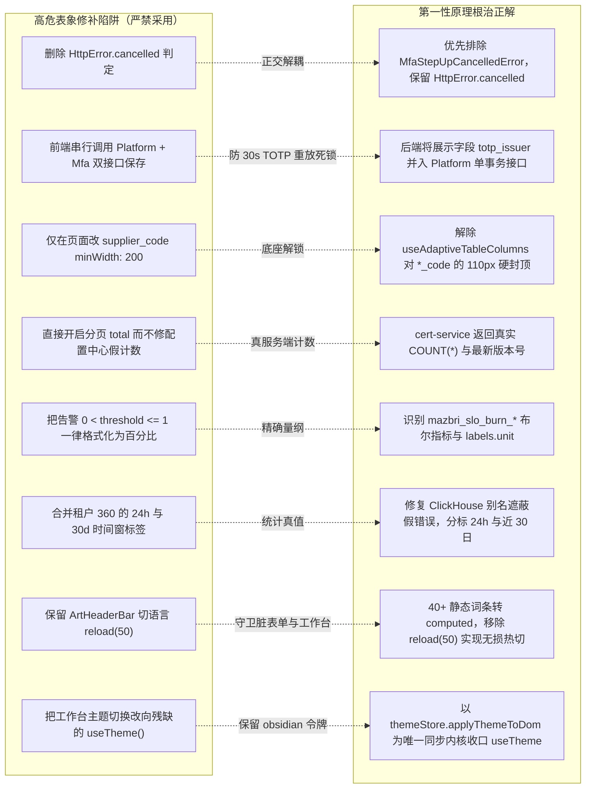

# 管理控制面（`mazbri-mgmt` / `mazbri-web`）第一性原理归因与八步全栈治理总览

## 1. 核心目标重构与四大第一性原理公理

多租户密码学网关与实时计费控制面的工程核心，并非孤立修补局部样式，而是建立**构造即正确（Correctness by Construction）**的跨层契约闭环——实现**零误读可观测（Zero-Misread Observability）**、**零误配操作安全（Zero-Misfire Operational Safety）**与**演进收敛性（Evolutionary Convergence）**。

结合 UI/UX 审计清单（`G-01`～`G-07`、`A-01`～`A-05`、`B-01`～`B-12`、`C-01`～`C-05`、`D-01`～`D-05`、`E-01`～`E-02`）、全栈源码遍历与 `127.0.0.1:9224` 实机核验，全部真实问题均归结为以下四条第一性原理的失守：

| 公理 | 第一性原理（系统核心不变量） | 当前架构失守本质 | 覆盖审计与扩展治理域 |
| :--- | :--- | :--- | :--- |
| **U1** | **前置能力门卫与代数取消信号正交公理**：特权访问遵循「先确认会话提权窗口、后挂载业务视图」单向门控；传输层请求作废（`AbortSignal` / `HttpError.cancelled`）与操作人拒绝二次验证（`MfaStepUpCancelledError`）属于正交和类型，严禁混同吞没或外溢假报错 | [useLatestRequest.ts](file:///workspace/rust-proj/mazbri/mazbri-web/src/composables/useLatestRequest.ts#L21-L34) 将 `MfaStepUpCancelledError` 误判为网络取消返回 `undefined`，致取消 MFA 后滞留可保存空白配置框；全站另有 14 处受保护调用缺少取消静默守卫；多阶段登录（口令挑战、强制改密、首次绑定 MFA）与最终会话签发的审计动作粒度失配 | `G-03`（含全站 47 个 MFA 端点调用面）、`D-04`、`D-05` |
| **U2** | **强量纲语义值与全链路时钟同构公理**：金额（整数分 vs. 十进制元 vs. `DECIMAL(18,6)` 微元）、比率、布尔告警标志、物理量纲与东八区墙钟必须在「输入 ➔ 传输 ➔ OLAP 聚合 ➔ 视图投影」全链路保持单射同构 | [account.vue](file:///workspace/rust-proj/mazbri/mazbri-web/src/views/mazbri/tenants/%5Bcode%5D/tabs/account.vue#L212-L350) 以「元」展示输入框却向后端整数「分」接口原样直传（100 倍少充/少退且余额 `< ¥100` 无法退款）；图表 X 轴读宿主本地时区、`SilencesPanel` 字面量 `[Z]` 产生 +8 小时偏移、ClickHouse 按日分桶未绑东八区；`tenant_errors_sql` 因 `SELECT ... AS error_code` 别名遮蔽 `WHERE` 同名列把 100% 成功请求判为 `UNKNOWN` 错误；SLO 裸露浮点数且 `burn_page` 布尔标志缺乏语义映射 | `A-01`, `A-03`, `B-02`, `B-04`, `B-12`, `C-01`, `C-02`, `C-04`, `C-05` |
| **U3** | **底座契约单源收敛与航空暗舱信噪比公理**：自适应列宽、服务端分页总数、主题 DOM 投影与状态徽标必须在底层原语唯一闭环，严禁用启发式硬上限覆盖业务契约或并存双轨实现；高饱和告警色仅分配给突破安全包线的真实异常 | [useAdaptiveTableColumns.ts](file:///workspace/rust-proj/mazbri/mazbri-web/src/composables/useAdaptiveTableColumns.ts#L221-L301) 将所有 `*_code` / `*_enabled` 列强行钳死在 `110px`；[query.rs](file:///workspace/rust-proj/mazbri/mazbri-bin/mazbri-mgmt/src/services/config_center/query.rs#L110-L115) 伪造 `(offset + count) + 1` 假总数且 [resource-table-shell/index.vue](file:///workspace/rust-proj/mazbri/mazbri-web/src/components/common/resource-table-shell/index.vue#L67-L86) 漏透传 `:show-total`；[useTheme.ts](file:///workspace/rust-proj/mazbri/mazbri-web/src/hooks/core/useTheme.ts#L30-L71) 漏维护 `data-dark-theme="obsidian"`；空活跃告警卡占据 `331px` 首屏高度；启停状态分裂为三种视觉原语 | `G-01`, `G-04`, `G-05`, `A-02`, `A-04`, `A-05`, `B-01`, `B-05`～`B-08`, `B-11`, `C-03`, `D-01`, `D-02` |
| **U4** | **领域意图原子化、无损双语热切与静态适应度门禁公理**：同一任务表单具备单一原子提交边界且不降级密码学安全域；语言切换不得销毁页面内存状态；组件、时区、双语与弹窗契约由 `node:test` 静态测试在 CI 期强制守卫 | 密码策略（`Category::Platform`）与 MFA 设置（`Category::Mfa`）分属不同提权域致页面分裂双保存按钮；工作台亮/暗双主题辅助字色低于 WCAG AA；[art-header-bar/index.vue](file:///workspace/rust-proj/mazbri/mazbri-web/src/components/core/layouts/art-header-bar/index.vue#L183-L188) 切语言调用 `reload(50)` 销毁 `<RouterView>` 未存状态，而全仓 40+ 处初始化期静态词条快照阻碍无刷新热切；上游模板残留死子树与 [main.ts](file:///workspace/rust-proj/mazbri/mazbri-web/src/main.ts#L15-L54) 弹窗表单全局原型篡改放大长期维护熵增 | `G-02`, `G-06`, `G-07`, `B-03`, `B-09`, `B-10`, `D-03`, `E-01`, `E-02` 及 `drafts.vue` 权限补齐 |

---

## 2. 关键边界核验与防次生故障红线

为严守 [AGENTS.md](file:///workspace/rust-proj/mazbri/AGENTS.md#L5-L11)「可破坏性重构」与「前后端彻底一致」铁律，工程落地强制执行以下八条架构防线：

1. **基线事实校准（避免无谓改动）**：`v0.6.6` 实机已满足 `ListQueryBar` `240px × 32px` `[不可更改]` 宽度与精简占位符、`ProductTopN` 内 `ElSegmented` 与 `ElSelect` `32px` 等高对齐、配置中心列表 `更新人` 列、供应商编辑态简洁 `取消 / 保存` 按钮及 `traces/detail.vue` 树形连接线与条内语义色对比度；治理聚焦真实存续缺陷与底层机制闭环，严禁破坏既有 `[不可更改]` 布局契约（如 `ListQueryBar` 定宽与 `SettingsCardGrid` 双栏对等宽度）。
2. **防 TOTP 30 秒防重放锁死（Step 07）**：后端 `advance_totp_step` 强制 30 秒步长单调递增；安全策略页合并保存必须在后端单次 `Category::Platform` 校验与单事务内更新密码策略及展示性 `totp_issuer`（将 `totp_digits` / `totp_period` 严格留在 `Category::Mfa`），严禁前端串行请求两个不同 `MfaCategory` 接口。
3. **防 ClickHouse 列别名遮蔽与聚合歧义（Step 02 / Step 06）**：ClickHouse 中 `SELECT expr AS col` 会在 `WHERE` 子句遮蔽同名物理列，`call_semantics.rs` 谓词必须显式限定 `request_logs.<col>`，`security_top_sql` 必须显式写作 `HAVING sum(fail_count) > 0`。
4. **防微元计费精度截断与分/元混算（Step 03）**：充值/退款表单以十进制「元」输入并经无损定点整数换算为后端 `i64`「分」；展示层采用纯十进制字符串 `2..6` 位自适应精度格式化，严禁 `Number().toFixed(2)` 抹零 `DECIMAL(18,6)` 亚分单价。
5. **防动态切语言销毁内存状态（Step 08）**：先将全仓 40+ 处初始化期 `t()` 静态列/选项快照收敛为响应式 `computed` 并清零 13 个非注释硬编码中文文件，再移除 `ArtHeaderBar` 的 `reload(50)`，确保在平台设置与免代码工作台（`/#/operations/upstream-supply/workbench`）热切语言时零组件卸载、零草稿丢失。

---

## 3. 八步串行可落地治理路线图与热替换矩阵

每一步均为独立可验证的闭环交付单元（完成前后端改动 ➔ 静态检查与全量单测全绿 ➔ 受影响容器原子热替换 ➔ `127.0.0.1:9224` 实机多维验证 ➔ 本地中文 Commit）：

| 步骤 | 方案文档 | 核心治理内容 | 覆盖审计与根因项 | 涉及编译与原子热替换服务 |
| :--- | :--- | :--- | :--- | :--- |
| **Step 01** | [01-step01-mfa-capability-gate-and-auth-audit-truth.md](./01-step01-mfa-capability-gate-and-auth-audit-truth.md) | MFA 前置能力守卫、取消信号正交解耦、多阶段登录审计闭环、配置中心真实计数/版本号与审计工具栏对齐 | `G-03`（全站 MFA 取消流）、`D-04`, `D-05` | `mazbri-web` ➔ `mazbri-cert-service`（`cert-1`）➔ `mazbri-mgmt`（`mgmt-1`） |
| **Step 02** | [02-step02-observability-clock-ssot-and-backend-predicates.md](./02-step02-observability-clock-ssot-and-backend-predicates.md) | 全链路东八区墙钟输入/输出同构、OLAP `HAVING` 与列别名遮蔽修复、空窗缩放防死锁与链路瀑布图精修 | `C-01`, `A-03`, `C-02` 及 `tenant_errors` 假错误修复 | `mazbri-web` ➔ `mazbri-analytics`（`analytics-1`）➔ `mazbri-mgmt`（`mgmt-1`） |
| **Step 03** | [03-step03-semantic-value-formatters-and-chart-primitives.md](./03-step03-semantic-value-formatters-and-chart-primitives.md) | 租户充退分/元量纲同构、`2..6` 位十进制微元原语、SLO 比率/布尔语义校准、柱图限宽与运行指标量纲去倍率 | `B-04`（含 P0 充退量纲）、`A-01`, `B-12`, `C-04`, `C-05` | `mazbri-web` ➔ `mazbri-mgmt`（`mgmt-1`） |
| **Step 04** | [04-step04-table-infrastructure-theme-pipeline-and-surfaces.md](./04-step04-table-infrastructure-theme-pipeline-and-surfaces.md) | 解锁 `useAdaptiveTableColumns` `110px` 钳制、分页 `total` 与封顶态透传、唯一同步主题内核与表格/按钮降噪 | `G-01`, `G-04`, `G-05`, `B-01`, `B-07`（列宽）、`B-11`, `D-01`, `D-02` | `mazbri-web` ➔ `mazbri-mgmt`（`mgmt-1`） |
| **Step 05** | [05-step05-dark-cockpit-dashboard-and-alert-ergonomics.md](./05-step05-dark-cockpit-dashboard-and-alert-ergonomics.md) | 暗舱式全局态势首屏降噪（保留证书临期预警）、分层 `OpsKpiRow` 栅格、固定量纲刻度与告警中心视图/条件收敛 | `A-02`, `A-04`, `A-05`, `C-03` | `mazbri-web` ➔ `mazbri-mgmt`（`mgmt-1`） |
| **Step 06** | [06-step06-entity-identity-bar-and-tenant-crypto-ledger-ux.md](./06-step06-entity-identity-bar-and-tenant-crypto-ledger-ux.md) | 轻量 `<EntityIdentityBar>` 原语、全站 `<StatusIndicator>` 双射、连接器草稿箱 RBAC 门控与三类实体详情精修 | `B-02`, `B-03`, `B-04`, `B-05`, `B-06`, `B-07`, `B-08` 及 `drafts.vue` | `mazbri-web` ➔ `mazbri-mgmt`（`mgmt-1`） |
| **Step 07** | [07-step07-workbench-viewport-and-security-settings-cohesion.md](./07-step07-workbench-viewport-and-security-settings-cohesion.md) | 免代码工作台紧凑屏自适应、亮/暗双主题 WCAG AA 校准、安全策略后端单事务保存与个人安全抽屉排版收敛 | `B-09`, `B-10`, `D-03`, `G-07` | `mazbri-web` ➔ `mazbri-mgmt`（`mgmt-1`） |
| **Step 08** | [08-step08-bilingual-sanitization-fitness-gates-and-topbar-closure.md](./08-step08-bilingual-sanitization-fitness-gates-and-topbar-closure.md) | 上游模板死资产清扫、13 处中文与 40+ 静态快照响应式清零、异常页自愈、`node:test` 架构门禁与无损双语顶栏收官 | `G-06`, `E-01`, `E-02`, `G-02` | `mazbri-web` ➔ `mazbri-mgmt`（`mgmt-1`） |

---

## 4. 强制执行门禁与交付准则

> [!IMPORTANT]
> **单步闭环交付红线**
> 1. **编译顺序与静态零警告**：每步先执行 `cd mazbri-web && pnpm build && pnpm test`（基于 `node --import tsx --test 'src/**/*.test.ts'` 跑通全仓前端单测），再执行 `mazbri-libs`（如有改动）与 `mazbri-bin` 的 `cargo clippy --release --locked --workspace --all-targets -- -D warnings` 及 `cargo test --release --locked --workspace --no-fail-fast`，确认 `git diff --exit-code -- mazbri-web/src/types/api/generated` 零漂移。
> 2. **容器原子热替换**：前端产物由 `mazbri-mgmt` 的 `build.rs` 静态内嵌；通过 `docker cp` 至容器 `/tmp/<target_bin>` 后执行 `chmod 755 && mv -f` 覆盖 `/usr/local/bin/<target_bin>`（注意 `mazbri-mazbri-cert-1` 内目标二进制名为 `mazbri-cert-service`）并按依赖顺序 `docker restart`，严禁执行 `docker compose up -d` 重建容器（且严禁触碰同机其他工程容器或浏览器非 Mazbri 标签页）。
> 3. **多维实机巡检**：每步热替换后通过 `chrome-devtools` MCP 连接 `127.0.0.1:9224`，在 `1920×1080`、`1440×900` 与 `1280×800` 视口、亮/暗双主题、`zh`/`en` 双语及 `R_ADMIN` / `R_FINANCE` / `R_VIEWER` 三角色下验证 DOM 对齐、接口响应与控制台零报错，确认 100% 闭环后执行本地详尽中文 Commit。
