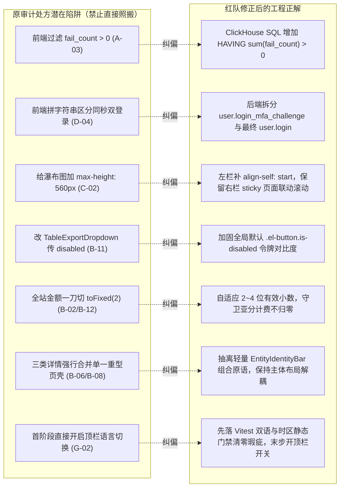

# 管理控制面（`mazbri-mgmt` / `mazbri-web`）审计核验、第一性原理归因与八步治理总览

## 1. 审计核验结论与底层问题重构

针对控制面 UI/UX 与架构审计检出的 36 项条目（`G-01`～`G-07`、`A-01`～`A-05`、`B-01`～`B-12`、`C-01`～`C-05`、`D-01`～`D-05`、`E-01`～`E-02`），源码交叉核验表明视觉与交互现象真实存在，但若按症状逐页打补丁或照搬原审计处方，将触发 **7 类根因误判与次生缺陷**（含违反 [AGENTS.md](file:///workspace/rust-proj/mazbri/AGENTS.md#L7-L8) 前后端一致性铁律、破坏粘性滚动布局、截断亚分计费精度、锁死超管逃生门禁等）。

多租户密码学网关与实时计费控制面的核心目标并非装饰性美观，而是**零误读可观测（Zero-Misread Observability）**与**零误配操作安全性（Zero-Misfire Operational Safety）**。全量问题可归结为以下四条第一性原理的失守：

| 公理编号 | 第一性原理（核心不变量） | 架构失守本质 | 覆盖审计条目簇 |
| :--- | :--- | :--- | :--- |
| **U1** | **前置能力门卫与有类型取消控制流公理**：特权读写遵循 `AcquireCapability -> FetchPayload -> MountView` 单向状态机；并发请求被新请求取代（`AbortSignal`）与操作人中止安全提权（`MfaStepUpCancelledError`）属于正交和类型，禁止混同吞没 | 先挂载空白可提交表单容器再异步触发鉴权；[useLatestRequest.ts](file:///workspace/rust-proj/mazbri/mazbri-web/src/composables/useLatestRequest.ts#L28) 以弱鸭子类型 `cancelled === true` 吞掉用户拒绝 MFA 异常；后端将 `mfa_pending` 半态请求提前记为最终登录成功 | `G-03`（含漏查的证书私钥解锁）、`D-04`、`D-05` |
| **U2** | **语义值类型与单一时钟源投影公理**：时间戳、比率、货币金额、CPU 核数与业务编码必须经由具备值域与精度守卫的语义类型（Semantic Value Descriptor）投影至视图，严禁视图层直接拼接裸标量或混用本地时区 | ECharts 图表手写 `new Date().getHours()` 读浏览器时区而表格固定 `Asia/Shanghai`；SLO 漏绑格式化器裸露 IEEE 754 浮点数；表头定死 `CPU (核)` 而单元格输出 `mCPU`；财务金额缺失币种或混淆整分与亚分（`DECIMAL(18,6)`）精度；`security_top_sql` 漏过滤零失败流量桶 | `A-01`, `A-03`, `B-02`, `B-12`, `C-01`, `C-04`, `C-05`, `G-05` |
| **U3** | **底座契约内聚与航空暗舱信噪比公理**：公共表格、分页、主题色阶与状态徽标必须由底层原语强制闭环，禁止依赖散装注释与 `!important` 样式劫持；高饱和告警色仅分配给突破安全包线的真实异常 | [constants.ts](file:///workspace/rust-proj/mazbri/mazbri-web/src/components/core/tables/art-table/constants.ts#L14-L25) 剥离分页 `total`；工作台绕过 `useTheme` 致暗色衍生变量失步；[el-ui.scss](file:///workspace/rust-proj/mazbri/mazbri-web/src/assets/styles/core/el-ui.scss#L763-L848) 强制将行内链接渲染为高饱和色块；零告警常态堆叠 `580px` 空白插画挤出核心流量曲线；启用状态分裂为三种组件形态 | `G-01`, `G-04`, `A-02`, `A-04`, `A-05`, `B-01`, `B-04`～`B-08`, `B-10`, `B-11`, `C-02`, `C-03`, `D-01`, `D-02` |
| **U4** | **领域意图内聚与编译期适应度门禁公理**：表单保存边界对齐用户任务意图而非后端物理表拆分；多语言与主题一致性必须由静态架构测试（Architecture Fitness Tests）守卫后方可向生产顶栏放行 | 同页拆分双保存按钮致 `totp_issuer` 静默漏存；密码学套件与单算法互斥关系隐式化；紧凑视口 `50%:50%` 死板平分裁切出站加密开关；缺乏静态门禁致硬编码中文与英文词缀拼接错误反复回流 | `G-02`, `G-06`, `G-07`, `B-03`, `B-09`, `D-03`, `E-01`, `E-02` |

---

## 2. 原审计报告关键误判纠偏与红队边界守卫

为防止实施阶段引入回归故障，本方案对原审计报告中的 7 处错误归因与边界盲区确立强制纠偏准则：

1. **防假性修改前端（`A-03` / `D-04`）**：安全榜单零失败记录与两阶段登录重复记录均源自后端 SQL 谓词与审计动作映射语义不严密，必须在 `mazbri-analytics` 与 `mazbri-mgmt` 源头修正，并同步通过 `every_action_has_frontend_label` 跨包契约测试。
2. **防亚分账务精度归零（`B-02` / `B-12`）**：平台账本采用 `DECIMAL(18,6)` 且存在 `¥0.0015 / 次` 级别单价；货币格式化器必须配置 `minimumFractionDigits: 2, maximumFractionDigits: 4`，避免小额消费显示为 `0.00`。
3. **防监控轮询布局跳动（`A-02`）**：全局态势开启自动轮询刷新时，告警摘要区不得在 `44px` 与 `280px` 间剧烈跳变，统一采用固定高度状态摘要条配合按需展开面板，避免值班员框选图表时发生误触偏移（CLS）。
4. **防海量日志表 `COUNT(*)` 慢查询雪崩（`G-01`）**：恢复分页器 `total` 显示时，实体配置表展示精确总数，ClickHouse 调用流水等高频海量表兼容封顶总数语义与直方图汇总口径。
5. **防误封超管强制发布逃生通道（`B-09`）**：免代码工作台在门禁未满时对「发布」作次级视觉降级与原因提示，不得用原生 `disabled` 彻底封死超级管理员 `force_publish` 弹窗链路。

---

## 3. 八步串行可落地治理路线图与全量条目映射

每一步均为独立闭环的原子交付单元（完成代码修改 ➔ 前后端全量编译与单测门禁 ➔ 容器热替换 ➔ 浏览器多分辨率/双主题/三角色实测 ➔ 本地提交）：

| 步骤 | 方案文档 | 治理核心主题 | 完整覆盖审计编号 | 涉及编译与热替换服务 |
| :--- | :--- | :--- | :--- | :--- |
| **Step 01** | [01-step01-mfa-capability-gate-and-auth-audit-truth.md](./01-step01-mfa-capability-gate-and-auth-audit-truth.md) | Step-up MFA 前置能力门卫、`useLatestRequest` 取消解耦与两阶段登录审计正名 | `G-03`, `D-04`, `D-05` | `mazbri-web` ➔ `mazbri-mgmt`（联动校验 `mazbri-cert-service` 单测） |
| **Step 02** | [02-step02-observability-clock-ssot-and-backend-predicates.md](./02-step02-observability-clock-ssot-and-backend-predicates.md) | 全站单一展示时钟源（`UTC+8`）、安全榜单后端谓词同构与链路瀑布图对齐 | `C-01`, `A-03`, `C-02` | `mazbri-web` ➔ `mazbri-analytics` ➔ `mazbri-mgmt` |
| **Step 03** | [03-step03-semantic-value-formatters-and-chart-primitives.md](./03-step03-semantic-value-formatters-and-chart-primitives.md) | 带值域与亚分精度守卫的语义格式化器、分类柱图限宽与资源监控量纲校准 | `A-01`, `B-12`, `C-04`, `C-05` | `mazbri-web` ➔ `mazbri-mgmt` |
| **Step 04** | [04-step04-table-infrastructure-theme-pipeline-and-surfaces.md](./04-step04-table-infrastructure-theme-pipeline-and-surfaces.md) | 表格底座契约闭环（`total`、数值右对齐、空态、行内动作降噪）与唯一主题管线 | `G-01`, `G-04`, `G-05`, `B-01`, `B-11`, `D-01`, `D-02` | `mazbri-web` ➔ `mazbri-mgmt` |
| **Step 05** | [05-step05-dark-cockpit-dashboard-and-alert-ergonomics.md](./05-step05-dark-cockpit-dashboard-and-alert-ergonomics.md) | 航空暗舱式全局态势首屏降噪、KPI 自适应 CSS Grid 与告警中心视图收敛 | `A-02`, `A-04`, `A-05`, `C-03` | `mazbri-web` ➔ `mazbri-mgmt` |
| **Step 06** | [06-step06-entity-identity-bar-and-tenant-crypto-ledger-ux.md](./06-step06-entity-identity-bar-and-tenant-crypto-ledger-ux.md) | 轻量实体身份顶栏原语、全站状态圆点徽标统一与租户/产品/供应商详情精修 | `B-02`, `B-03`, `B-04`, `B-05`, `B-06`, `B-07`, `B-08` | `mazbri-web` ➔ `mazbri-mgmt` |
| **Step 07** | [07-step07-workbench-viewport-and-security-settings-cohesion.md](./07-step07-workbench-viewport-and-security-settings-cohesion.md) | 免代码工作台紧凑屏自适应、暗色对比度提亮与平台安全策略单按钮脏状态闭环 | `B-09`, `B-10`, `D-03`, `G-07` | `mazbri-web` ➔ `mazbri-mgmt` |
| **Step 08** | [08-step08-bilingual-sanitization-fitness-gates-and-topbar-closure.md](./08-step08-bilingual-sanitization-fitness-gates-and-topbar-closure.md) | 全量双语与微文案清零、异常页自愈闭环、Vitest 架构门禁与顶栏身份/语言开关收官 | `G-06`, `E-01`, `E-02`, `G-02` | `mazbri-web` ➔ `mazbri-mgmt` |

---

## 4. 强制执行门禁与交付准则

> [!IMPORTANT]
> **单步闭环红线**
> 1. **编译顺序与静态零警告**：每步先执行 `cd mazbri-web && pnpm build && pnpm test`（覆盖全仓 `src/**/*.test.ts`），再执行 `mazbri-libs`（如有改动）与 `mazbri-bin` 的 `cargo clippy --release --locked --workspace --all-targets -- -D warnings` 及 `cargo test --release --locked --workspace --no-fail-fast`，确认 `git diff --exit-code -- mazbri-web/src/types/api/generated` 零漂移。
> 2. **容器原子热替换**：前端产物由 `mazbri-mgmt` 的 `build.rs` 静态内嵌；通过 `docker cp` 至容器 `/tmp/<bin>` 后执行 `chmod 755 && mv -f` 原子覆盖 `/usr/local/bin/<bin>` 并 `docker restart`，严禁执行 `docker compose up -d` 重建容器导致可写层回退。
> 3. **多维实机巡检**：每步热替换后连接 `9223`/`9224` 浏览器，在 `1920×1080` 与 `1440×900` / `1280×800` 视口、亮/暗双主题、`zh`/`en` 双语及 `R_ADMIN` / `R_FINANCE` / `R_VIEWER` 三角色下验证 DOM 对齐、交互闭环与控制台零报错后，方可执行本地中文 Commit 进入下一步。
